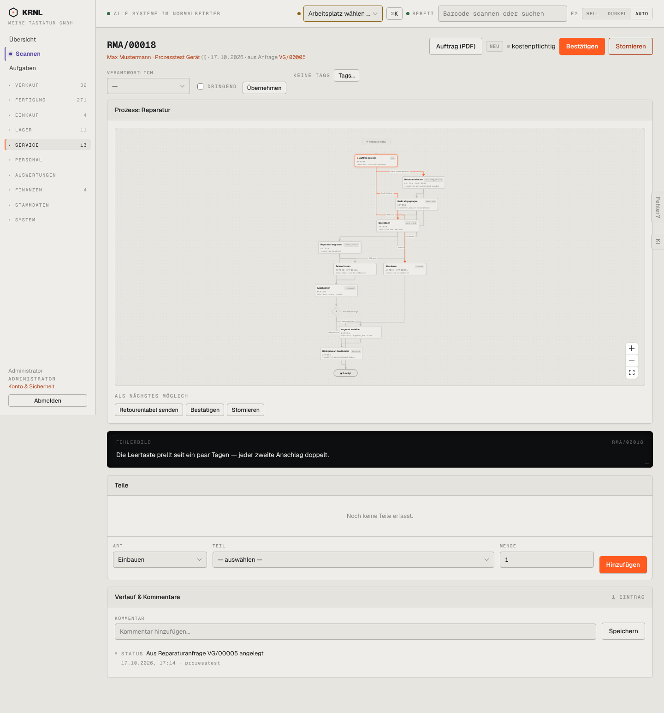

# 601-reparatur-neu — Reparatur neu

- **Bereich:** Service
- **Route:** `/reparatur/a76297c3-64de-4118-8661-e8a61e42ca21`
- **Note:** 3 / 5
- **Zweck:** Reparaturauftrag im Status Neu (aus Anfrage)
- **Messwerte:** HTTP 200 · Ladezeit 928 ms · Seitenhöhe 1546 px · horizontaler Überlauf nein · Texte < 11 px: 68

## Was gut ist

- PDF ‚Auftrag‘ im Kopf
- Fehlerbild prominent
- Teileerfassung (Einbauen/Ausbauen)

## Befunde

| Schwere | Kategorie | Befund | Vorschlag |
|---|---|---|---|
| **hoch** | Layout | Das Prozessdiagramm (≈ 600 px, Schrift unlesbar) steht vor dem Fehlerbild und den Teilen – das Wichtigste beginnt erst unterhalb des Falzes. | Kompakter Stepper oben, Diagramm einklappbar unten. |
| **mittel** | Schritte | ‚Bestätigen‘ orange im Kopf und erneut im Prozess-Panel; ‚Bestätigen‘ ist vor Geräteeingang möglich. | Einen Ort für die Aktion; Bestätigen erst nach Eingang/Diagnose empfehlen. |

[← zur Übersicht](../README.md)
