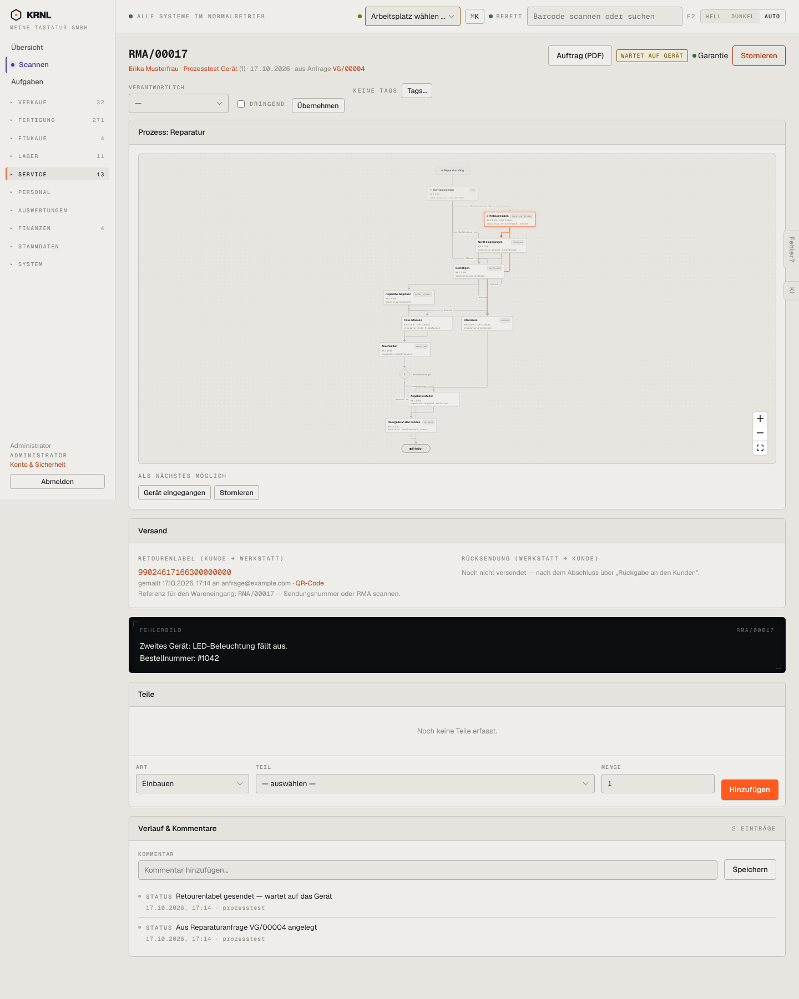

# 602-reparatur-wartet — Reparatur wartet auf Gerät

- **Bereich:** Service
- **Route:** `/reparatur/85b8358f-79d7-474e-9b7a-50153a93c8c1`
- **Note:** 4 / 5
- **Zweck:** Reparatur wartet auf das Kundengerät
- **Messwerte:** HTTP 200 · Ladezeit 890 ms · Seitenhöhe 1802 px · horizontaler Überlauf nein · Texte < 11 px: 72

## Was gut ist

- Versandkarte mit Retourenlabel, QR-Code und Scan-Hinweis
- Rücksendung erklärt

## Befunde

| Schwere | Kategorie | Befund | Vorschlag |
|---|---|---|---|
| **niedrig** | Layout | Fehlerbild als schwarzer Terminal-Block – stilfremd zum Rest. | Helle Hinweiskarte. |

[← zur Übersicht](../README.md)
