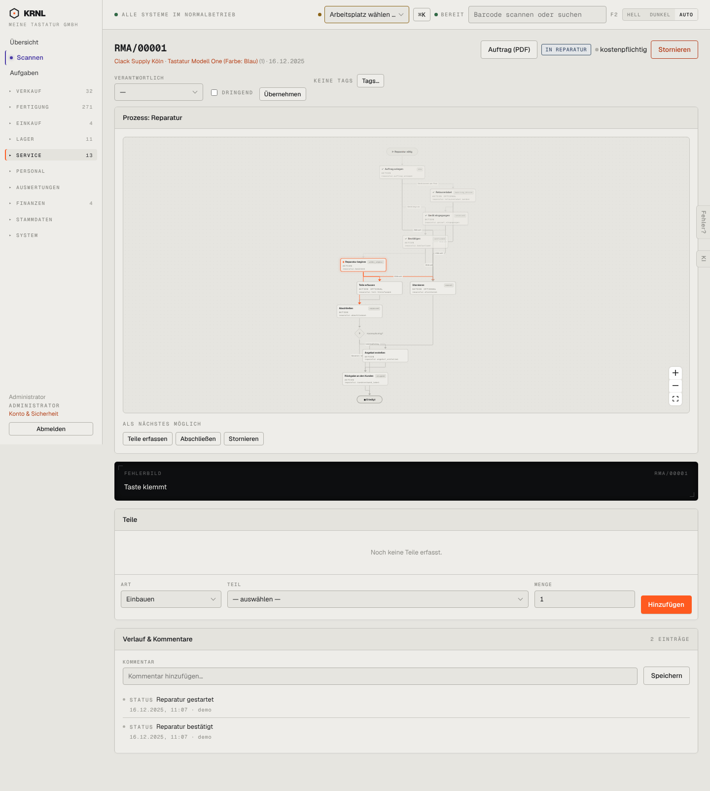

# 603-reparatur-inarbeit — Reparatur in Arbeit

- **Bereich:** Service
- **Route:** `/reparatur/7ba986b2-d7ac-4199-b3a7-b28d3941993f`
- **Note:** 3 / 5
- **Zweck:** Reparatur in Arbeit
- **Messwerte:** HTTP 200 · Ladezeit 834 ms · Seitenhöhe 1602 px · horizontaler Überlauf nein · Texte < 11 px: 70

## Was gut ist

- Nächste Schritte Teile erfassen/Abschließen

## Befunde

| Schwere | Kategorie | Befund | Vorschlag |
|---|---|---|---|
| **mittel** | Status | Seit 10 Monaten ‚In Reparatur‘ ohne Hinweis auf Liegezeit. | ‚in Reparatur seit 305 Tagen‘ im Kopf. |

[← zur Übersicht](../README.md)
