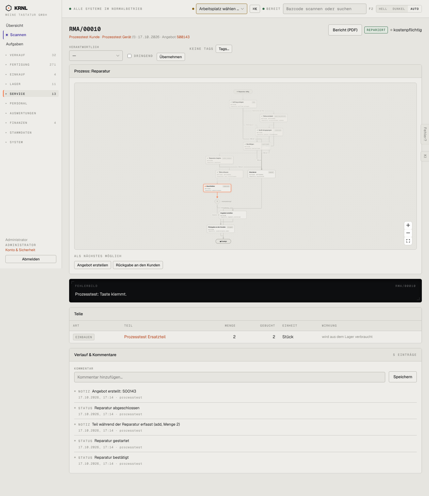

# 604-reparatur-repariert — Reparatur repariert

- **Bereich:** Service
- **Route:** `/reparatur/b91fc0d6-57dd-4d8a-9de8-6c7c88658f0a`
- **Note:** 2 / 5
- **Zweck:** Reparierter, kostenpflichtiger Auftrag
- **Messwerte:** HTTP 200 · Ladezeit 818 ms · Seitenhöhe 1663 px · horizontaler Überlauf nein · Texte < 11 px: 80

## Was gut ist

- Teile mit Wirkung (aus dem Lager verbraucht)
- Bericht-PDF

## Befunde

| Schwere | Kategorie | Befund | Vorschlag |
|---|---|---|---|
| **hoch** | Logik | Bei kostenpflichtiger Reparatur entsteht das Angebot erst nach der Reparatur (Verlauf: abgeschlossen → Angebot S00143); ‚Angebot erstellen‘ wird trotz vorhandenem Angebot weiter angeboten. | Kostenvoranschlag/Freigabe vor Reparaturbeginn; ‚Angebot erstellen‘ ausblenden, wenn vorhanden (Link stattdessen). |
| **niedrig** | Texte | Verlauf ‚Teil während der Reparatur erfasst (add, Menge 2)‘ – Code ‚add‘. | ‚eingebaut‘. |

[← zur Übersicht](../README.md)
