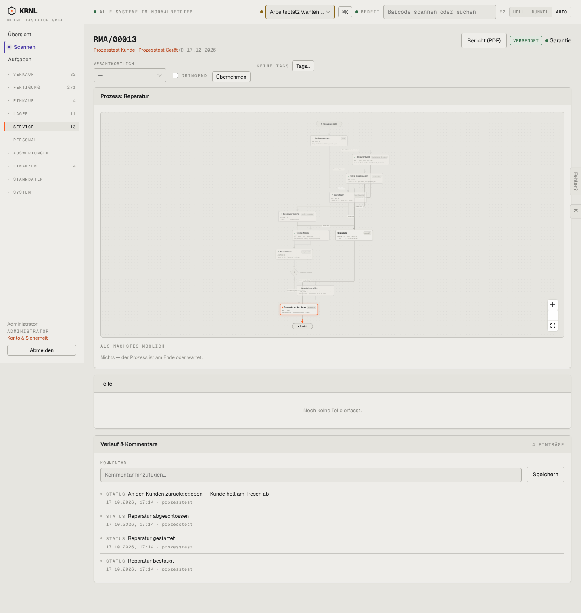

# 605-reparatur-versendet — Reparatur versendet

- **Bereich:** Service
- **Route:** `/reparatur/f5891410-ea77-49b4-af17-2e7712f7f14f`
- **Note:** 3 / 5
- **Zweck:** Abgeschlossene, zurückgegebene Reparatur
- **Messwerte:** HTTP 200 · Ladezeit 814 ms · Seitenhöhe 1520 px · horizontaler Überlauf nein · Texte < 11 px: 69

## Was gut ist

- Verlauf vollständig

## Befunde

| Schwere | Kategorie | Befund | Vorschlag |
|---|---|---|---|
| **niedrig** | Texte | Status ‚VERSENDET‘, obwohl der Kunde laut Verlauf am Tresen abgeholt hat. | Status ‚Zurückgegeben‘ (Versand/Abholung als Detail). |
| **niedrig** | Texte | ‚Nichts — der Prozess ist am Ende oder wartet.‘ | ‚Abgeschlossen am …‘. |

[← zur Übersicht](../README.md)
