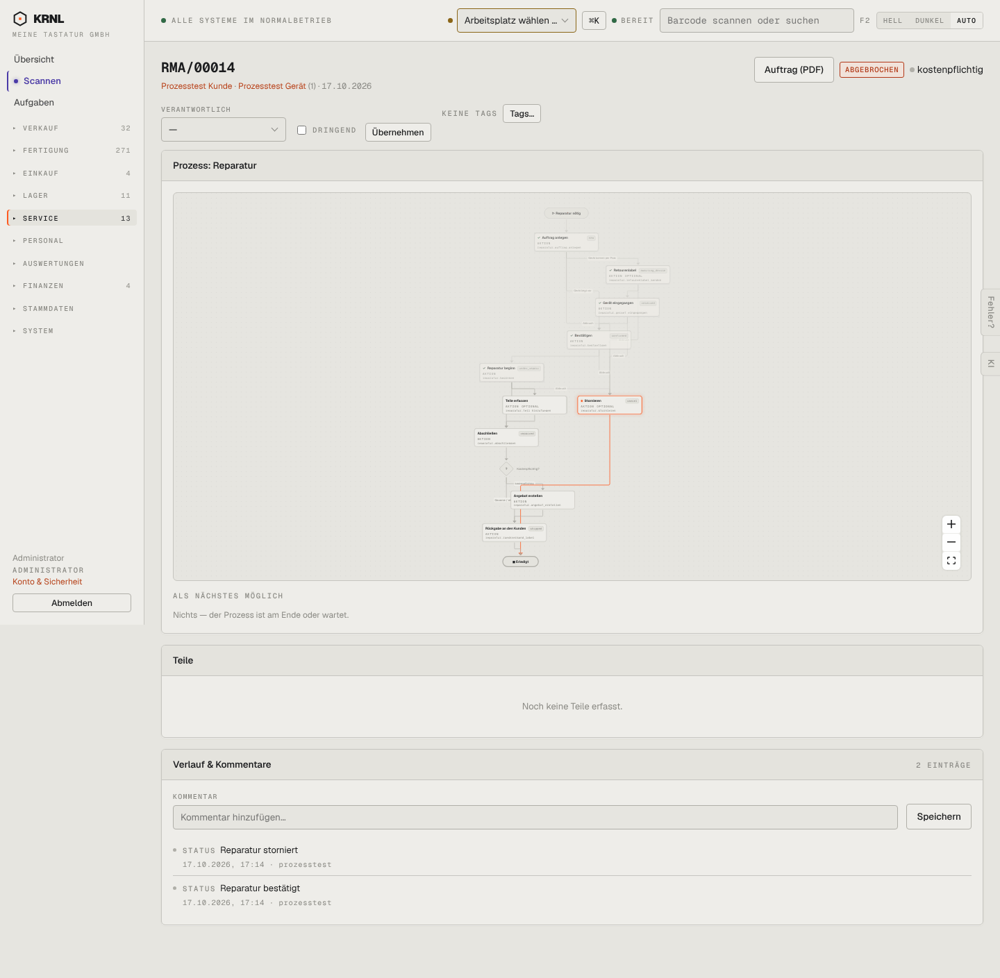

# 606-reparatur-storniert — Reparatur storniert

- **Bereich:** Service
- **Route:** `/reparatur/27216bfe-8031-4a96-ad86-f0860157f3b8`
- **Note:** 3 / 5
- **Zweck:** Stornierte Reparatur
- **Messwerte:** HTTP 200 · Ladezeit 809 ms · Seitenhöhe 1409 px · horizontaler Überlauf nein · Texte < 11 px: 65

## Was gut ist

- Status rot

## Befunde

| Schwere | Kategorie | Befund | Vorschlag |
|---|---|---|---|
| **mittel** | Schritte | Diagramm führt vom Knoten Stornieren über ‚Rückgabe an den Kunden‘ zu Erledigt (hervorgehoben) – suggeriert eine Rückgabe. | Storniert als eigener Endknoten. |
| **niedrig** | Konsistenz | Kopf ‚ABGEBROCHEN‘, Verlauf ‚Reparatur storniert‘. | Ein Begriff. |

[← zur Übersicht](../README.md)
