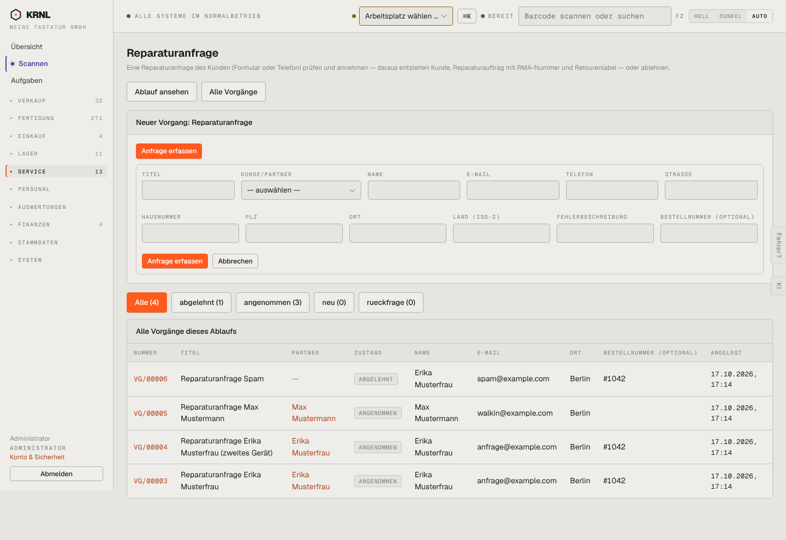

# 610-reparaturanfragen — Reparaturanfragen

- **Bereich:** Service
- **Route:** `/vorgaenge/prozess/reparatur_anfrage`
- **Note:** 3 / 5
- **Zweck:** Reparaturanfragen prüfen, annehmen/ablehnen, telefonisch erfassen
- **Messwerte:** HTTP 200 · Ladezeit 832 ms · Seitenhöhe 990 px · horizontaler Überlauf nein · Texte < 11 px: 38

## Was gut ist

- Zustandsfilter mit Zählern
- Bestellnummer und Kontakt in der Liste

## Befunde

| Schwere | Kategorie | Befund | Vorschlag |
|---|---|---|---|
| **mittel** | Eingabe | Erfassungsformular mit 12 gleich breiten Feldern im Raster; Fehlerbeschreibung ist ein einzeiliges Feld. | Gruppiert (Kontakt · Adresse · Anliegen), Beschreibung mehrzeilig. |
| **niedrig** | Konsistenz | Zwei orange ‚Anfrage erfassen‘-Knöpfe; Filter ‚rueckfrage‘ ohne Umlaut, alles kleingeschrieben. | Siehe 121. |

[← zur Übersicht](../README.md)
