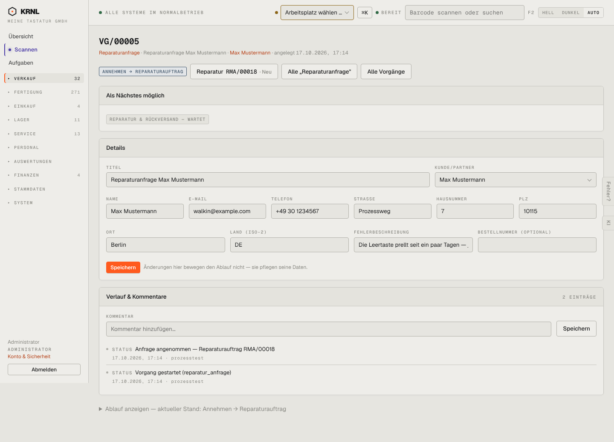

# 611-reparaturanfrage-angenommen — Reparaturanfrage angenommen

- **Bereich:** Service
- **Route:** `/vorgaenge/90e93c5e-c158-4586-ba69-32ec995c01e8`
- **Note:** 3 / 5
- **Zweck:** Angenommene Reparaturanfrage
- **Messwerte:** HTTP 200 · Ladezeit 852 ms · Seitenhöhe 1039 px · horizontaler Überlauf nein · Texte < 11 px: 48

## Was gut ist

- Link zur entstandenen Reparatur RMA/00018 mit Status

## Befunde

| Schwere | Kategorie | Befund | Vorschlag |
|---|---|---|---|
| **mittel** | Navigation | In der Seitenleiste ist ‚VERKAUF‘ aktiv, obwohl die Reparaturanfrage zu Service gehört (Vorgänge hängen technisch unter Verkauf). | Aktiver Bereich aus dem Prozessbereich ableiten. |
| **mittel** | Status | Kopfetikett zeigt Schrittnamen ‚ANNEHMEN → REPARATURAUFTRAG‘ statt Zustand ‚Angenommen‘. | Siehe 122. |

[← zur Übersicht](../README.md)
