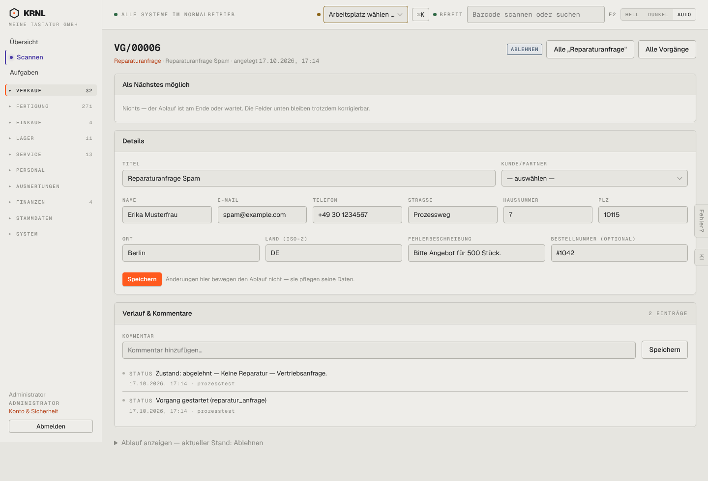

# 612-reparaturanfrage-abgelehnt — Reparaturanfrage abgelehnt

- **Bereich:** Service
- **Route:** `/vorgaenge/723fb41a-0a64-4f53-b054-1553ec64cd6f`
- **Note:** 3 / 5
- **Zweck:** Abgelehnte Reparaturanfrage
- **Messwerte:** HTTP 200 · Ladezeit 835 ms · Seitenhöhe 980 px · horizontaler Überlauf nein · Texte < 11 px: 47

## Was gut ist

- Grund im Verlauf (‚Keine Reparatur — Vertriebsanfrage‘)

## Befunde

| Schwere | Kategorie | Befund | Vorschlag |
|---|---|---|---|
| **mittel** | Status | Kopfetikett ‚ABLEHNEN‘ (Verb) statt ‚Abgelehnt‘; Navigation markiert ‚VERKAUF‘. | Siehe 123/611. |

[← zur Übersicht](../README.md)
