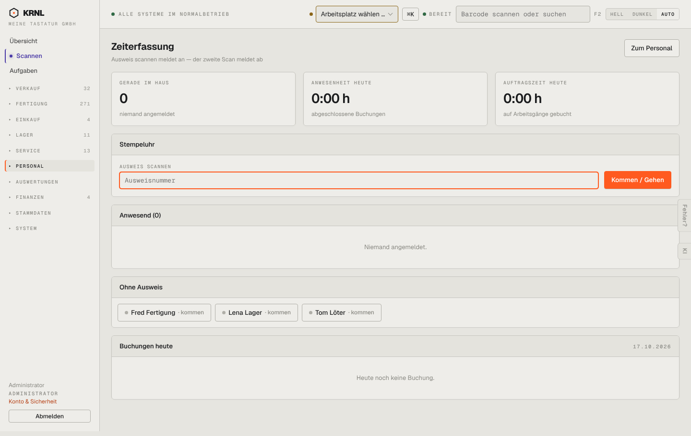

# 700-zeiterfassung — Zeiterfassung

- **Bereich:** Personal
- **Route:** `/zeiterfassung`
- **Note:** 4 / 5
- **Zweck:** Stempeluhr: Kommen/Gehen per Ausweis
- **Messwerte:** HTTP 200 · Ladezeit 711 ms · Seitenhöhe 910 px · horizontaler Überlauf nein · Texte < 11 px: 18

## Was gut ist

- Großes Scanfeld mit Fokus
- ‚Ohne Ausweis‘-Schnellknöpfe je Mitarbeiter
- Kennzahlen Anwesenheit/Auftragszeit

## Befunde

| Schwere | Kategorie | Befund | Vorschlag |
|---|---|---|---|
| **niedrig** | Navigation | Liegt unter Personal, wird aber an der Station (Tablet am Eingang) genutzt – ohne Kioskmodus. | Kioskansicht ohne Navigation (wie Scanner). |

[← zur Übersicht](../README.md)
