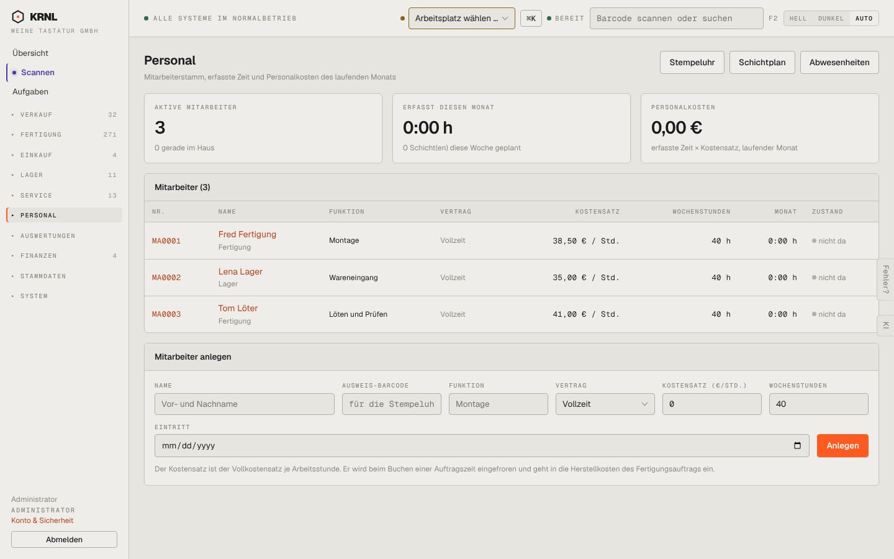

# 701-mitarbeiter — Mitarbeiter

- **Bereich:** Personal
- **Route:** `/personal`
- **Note:** 4 / 5
- **Zweck:** Mitarbeiterstamm mit Kostensatz und Monatszeiten
- **Messwerte:** HTTP 200 · Ladezeit 814 ms · Seitenhöhe 900 px · horizontaler Überlauf nein · Texte < 11 px: 31

## Was gut ist

- Kennzahlen (aktiv, erfasst, Personalkosten)
- Erklärung zum eingefrorenen Kostensatz

## Befunde

| Schwere | Kategorie | Befund | Vorschlag |
|---|---|---|---|
| **mittel** | Daten | ‚Erfasst diesen Monat 0:00 h / Personalkosten 0,00 €‘, obwohl die Mitarbeiterakte 40 Zeitbuchungen (bis 16.09.) zeigt – Monatsbezug nicht erkennbar (Oktober leer). | Monat im Kennzahltitel nennen (‚Oktober 2026‘) und Vormonat zum Vergleich. |
| **niedrig** | Eingabe | Kostensatz-Feld mit ‚0‘ vorbelegt; Eintrittsdatum US-Format. | Leer + Pflicht; Datum de-DE. |

[← zur Übersicht](../README.md)
