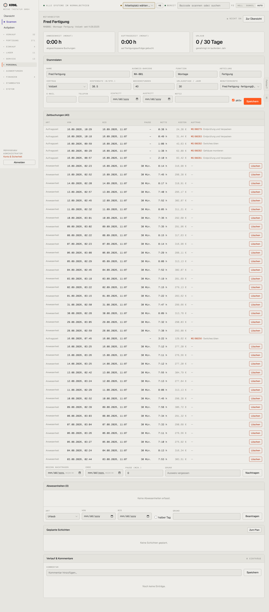

# 702-mitarbeiter-detail — Mitarbeiter Detail

- **Bereich:** Personal
- **Route:** `/personal/6dba678e-deb1-4c67-aa24-8b9ff058ff49`
- **Note:** 3 / 5
- **Zweck:** Mitarbeiterakte: Stammdaten, Zeitbuchungen, Abwesenheiten, Schichten
- **Messwerte:** HTTP 200 · Ladezeit 876 ms · Seitenhöhe 3274 px · horizontaler Überlauf nein · Texte < 11 px: 49

## Was gut ist

- Auftragszeiten mit Bezug zum Fertigungsauftrag und Kosten
- Nachtragen mit Grund

## Befunde

| Schwere | Kategorie | Befund | Vorschlag |
|---|---|---|---|
| **mittel** | Daten | Anwesenheiten beginnen täglich zwischen 02:20 und 03:30 Uhr und enden exakt 11:07 – auffällige Testdaten, aber auch kein Plausibilitätshinweis (Nachtarbeit?). | Plausibilitätsprüfung (Arbeitszeitgesetz, Ruhezeiten) mit Warnsymbol. |
| **mittel** | Konsistenz | 40 rote ‚Löschen‘-Knöpfe untereinander; keine Gruppierung nach Tag/Woche. | Gruppierung je Tag mit Tagessumme, Löschen im Zeilenmenü. |
| **niedrig** | Typografie | Kostensatz ‚38.5‘ mit Dezimalpunkt. | de-DE. |

[← zur Übersicht](../README.md)
