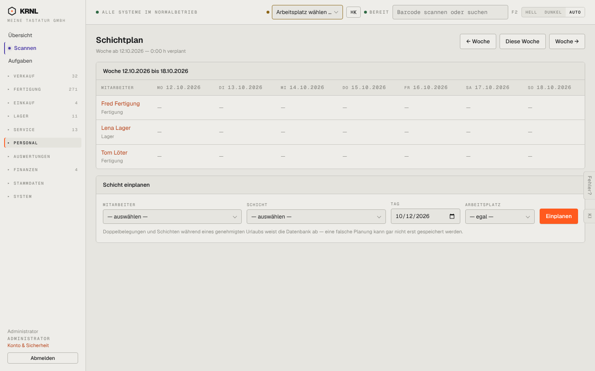

# 703-schichtplan — Schichtplan

- **Bereich:** Personal
- **Route:** `/personal/schichtplan`
- **Note:** 3 / 5
- **Zweck:** Schichten je Woche planen
- **Messwerte:** HTTP 200 · Ladezeit 802 ms · Seitenhöhe 900 px · horizontaler Überlauf nein · Texte < 11 px: 18

## Was gut ist

- Wochenraster mit Navigation
- Hinweis, dass Doppelbelegungen die Datenbank verhindert

## Befunde

| Schwere | Kategorie | Befund | Vorschlag |
|---|---|---|---|
| **mittel** | Eingabe | Schichten nur über das Formular unten planbar, nicht per Klick ins Raster. | Zelle anklicken → Schicht wählen. |
| **niedrig** | Eingabe | Schicht-Auswahl leer, ohne Hinweis, wo Schichtarten gepflegt werden. | Leerzustand mit Link. |

[← zur Übersicht](../README.md)
