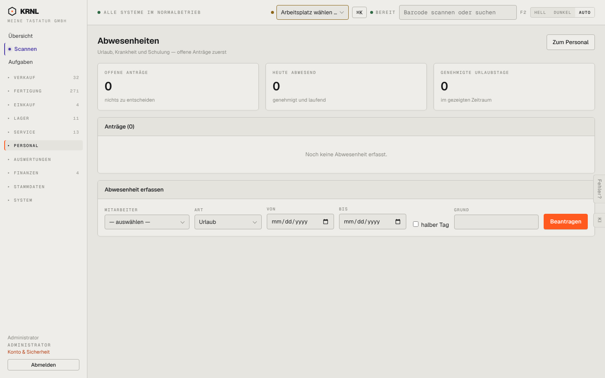

# 704-abwesenheiten — Abwesenheiten

- **Bereich:** Personal
- **Route:** `/personal/abwesenheiten`
- **Note:** 4 / 5
- **Zweck:** Urlaub/Krankheit beantragen und entscheiden
- **Messwerte:** HTTP 200 · Ladezeit 814 ms · Seitenhöhe 900 px · horizontaler Überlauf nein · Texte < 11 px: 21

## Was gut ist

- Offene Anträge zuerst, Kennzahlen

## Befunde

| Schwere | Kategorie | Befund | Vorschlag |
|---|---|---|---|
| **niedrig** | Funktion | Kein Kalender-/Teamüberblick (wer ist wann weg). | Monatsübersicht je Mitarbeiter. |

[← zur Übersicht](../README.md)
