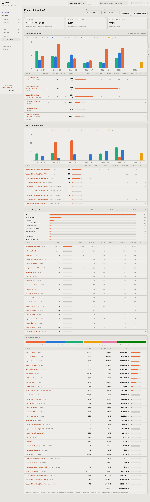

# 800-mengen — Mengen & Abverkauf

- **Bereich:** Auswertungen & Finanzen
- **Route:** `/auswertungen`
- **Note:** 3 / 5
- **Zweck:** Bestand, Produktion, verbaute Komponenten, Abverkauf je Zeitraum
- **Messwerte:** HTTP 200 · Ladezeit 845 ms · Seitenhöhe 4813 px · horizontaler Überlauf nein · Texte < 11 px: 45

## Was gut ist

- Zeitraumwahl, Kennzahlen, Diagramme mit Tabellen darunter

## Befunde

| Schwere | Kategorie | Befund | Vorschlag |
|---|---|---|---|
| **hoch** | Daten | Abverkaufsquote über 100 % (122 %, 465 %, 189 %) – Folge negativer Bestände; die Kennzahl ist so unbrauchbar und wird nicht erklärt. | Quote bei negativem Bestand ‚n. v.‘ + Hinweis auf Bestandsfehler. |
| **mittel** | Layout | Fortschrittsbalken der Quote laufen über die Spalte in die Monatswerte (überdecken Zahlen). | Balken auf 100 % begrenzen. |
| **mittel** | Konsistenz | Farben der Varianten wechseln zwischen den Diagrammen (Schwarz einmal blau, einmal orange). | Feste Farbe je Variante. |
| **niedrig** | Eingabe | Zeitraumfelder im US-Format; Monatsachsen ‚2026-04‘ statt ‚Apr 26‘. | de-DE. |

[← zur Übersicht](../README.md)
