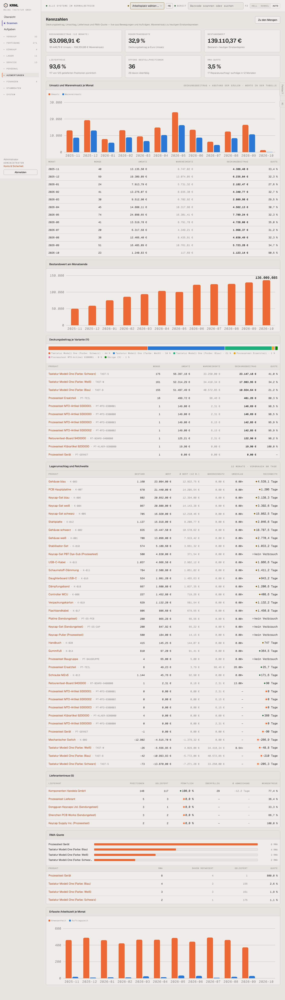

# 801-kennzahlen — Kennzahlen

- **Bereich:** Auswertungen & Finanzen
- **Route:** `/auswertungen/kennzahlen`
- **Note:** 3 / 5
- **Zweck:** Deckungsbeitrag, Liefertreue, RMA-Quote, Bestandswert
- **Messwerte:** HTTP 200 · Ladezeit 855 ms · Seitenhöhe 5043 px · horizontaler Überlauf nein · Texte < 11 px: 98

## Was gut ist

- Sechs klare Kennzahlen mit Herleitung
- Monatstabelle zum Diagramm

## Befunde

| Schwere | Kategorie | Befund | Vorschlag |
|---|---|---|---|
| **mittel** | Daten | Bestandswert 139.110,37 € hier, 136.009,08 € auf Mengen/Bewertung – zwei Werte ohne Erklärung (heutiger Einstand vs. gleitender Durchschnitt steht nur klein). | Beide Werte nebeneinander mit Begriff (‚zu Wiederbeschaffung‘ / ‚bilanziell‘). |
| **mittel** | Daten | Oktober mit 90,5 % Quote (Teilmonat, Wareneinsatz 117 €) verzerrt das Bild. | Laufenden Monat kennzeichnen (‚bis 17.10.‘). |
| **niedrig** | Typografie | Diagrammbeschriftung ‚136.009,085‘ mit drei Nachkommastellen. | Gerundet ‚136 T€‘. |

[← zur Übersicht](../README.md)
