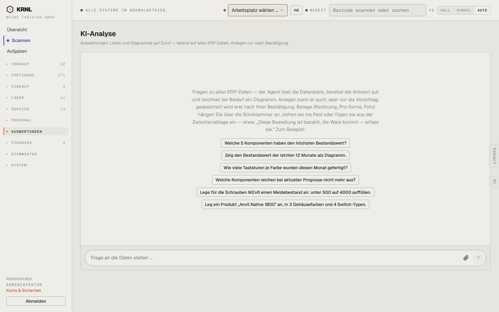

# 802-ki — KI-Analyse

- **Bereich:** Auswertungen & Finanzen
- **Route:** `/ki`
- **Note:** 4 / 5
- **Zweck:** KI-Analyse: Fragen an die Daten, Anlegen nur nach Bestätigung
- **Messwerte:** HTTP 200 · Ladezeit 729 ms · Seitenhöhe 900 px · horizontaler Überlauf nein · Texte < 11 px: 13

## Was gut ist

- Beispielfragen als Knöpfe
- Anhänge per Büroklammer/Drag&Drop erklärt
- Sicherheitsprinzip (Vorschlag → Bestätigung) klar

## Befunde

| Schwere | Kategorie | Befund | Vorschlag |
|---|---|---|---|
| **niedrig** | Konsistenz | Zusätzlich gibt es die KI-Lasche rechts und ‚Sprechen‘ – drei Einstiege in die KI. | Ein KI-Einstieg mit Modi (Text/Sprache). |

[← zur Übersicht](../README.md)
