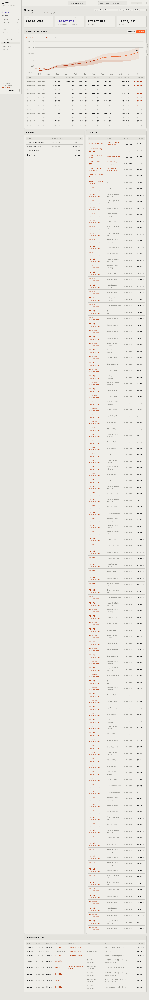

# 850-cashflow — Cashflow

- **Bereich:** Auswertungen & Finanzen
- **Route:** `/finanzen`
- **Note:** 2 / 5
- **Zweck:** Finanzübersicht: Kassenstand, Cashflow-Prognose, fällige Zahlungen, Register
- **Messwerte:** HTTP 200 · Ladezeit 6120 ms · Seitenhöhe 9612 px · horizontaler Überlauf nein · Texte < 11 px: 59

## Was gut ist

- Prognose mit Best/Worst-Band und Unterdeckung rot
- Monatstabelle nach Quellen (Einzahlungen, Bestellungen, Verträge, Darlehen, Steuern)
- Zahlungsregister mit Quelle

## Befunde

| Schwere | Kategorie | Befund | Vorschlag |
|---|---|---|---|
| **kritisch** | Logik | Cashflow-Oktober enthält Bestellungen über 285.652,96 € (u. a. die nicht bestätigte CNY-Anfrage P00036 mit 19 % USt und alle seit Monaten überfälligen Testbestellungen) → Fremdkapitalbedarf 175.162 € und ‚Fällig in 14 Tagen 257.107,98 € (122 Posten)‘ – die Kernaussage der Seite ist dadurch falsch. | Nur bestätigte Bestellungen einrechnen; Anfragen getrennt als ‚möglich‘; überfällige Zahlungen als eigener Block statt im laufenden Monat. |
| **hoch** | Logik | ‚Fällig (14 Tage)‘ listet über 100 Kundenrechnungen RE-0001… mit Fälligkeit 30.10.2026 als Einzelzeilen (Seite 9.600 px lang); Ein- und Auszahlungen ohne Vorzeichen/Farbe gemischt. | Getrennte Spalten ‚Eingänge erwartet‘/‚Ausgänge fällig‘, gruppiert nach Tag mit Summen, Top 10 + ‚alle anzeigen‘. |
| **mittel** | Daten | Bankkonto ‚Ohne Konto −571,20 €‘ fließt in den Kassenstand ein. | Zahlungen ohne Konto als Klärfall, nicht als Konto. |
| **mittel** | Konsistenz | Fremdkapitalbedarf in Violett. Laut Designsystem (globals.css) ist Violett der seltene Entscheidungsakzent (Freigaben, Befugnis-Schritte, KI-Vorschläge). Eine Prognosezahl ist keine Entscheidung – die Farbsemantik verwässert; als Risiko gehört sie in die Gefahrenfarbe. | Gefahrenfarbe (rot) aus den Tokens. |
| **niedrig** | Texte | Register: Zweck ‚Zins 469.61, Tilgung 1664.74‘ mit Dezimalpunkt; Quelle ‚kundenrechnung‘ kleingeschrieben/ohne Link. | de-DE, Link auf die Rechnung. |

[← zur Übersicht](../README.md)
