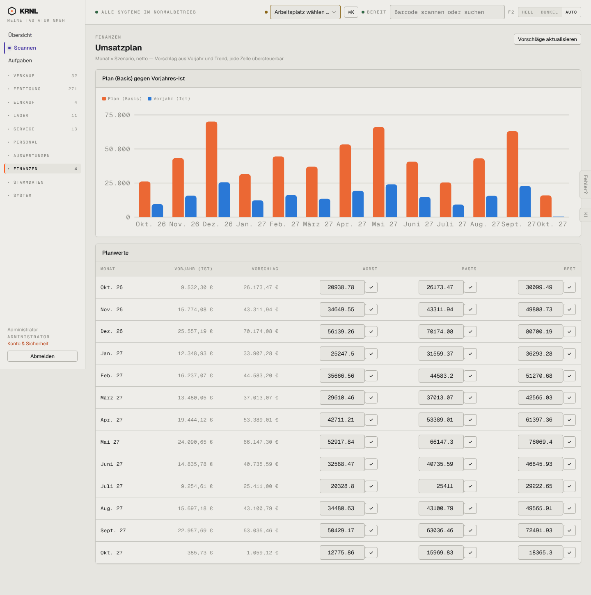

# 851-umsatzplan — Umsatzplan

- **Bereich:** Auswertungen & Finanzen
- **Route:** `/finanzen/plan`
- **Note:** 2 / 5
- **Zweck:** Umsatzplan je Monat und Szenario
- **Messwerte:** HTTP 200 · Ladezeit 959 ms · Seitenhöhe 1451 px · horizontaler Überlauf nein · Texte < 11 px: 36

## Was gut ist

- Vorschlag aus Vorjahr und Trend, je Zelle übersteuerbar

## Befunde

| Schwere | Kategorie | Befund | Vorschlag |
|---|---|---|---|
| **hoch** | Logik | Vorschlag liegt durchgehend beim 2,7-fachen des Vorjahres (Okt 9.532 € → 26.173 €) ohne erkennbare Begründung – der Trend ist offensichtlich falsch berechnet oder nicht erklärt. | Wachstumsannahme sichtbar machen (‚+x % ggü. Vorjahr‘) und begrenzen; Methode erklären. |
| **mittel** | Eingabe | 36 Eingabefelder mit Rohwerten ‚20938.78‘ (Punkt, keine Tausender) und je eigenem ✓-Knopf. | Formatierte Zellen, Speichern beim Verlassen, Prozent-Schnellanpassung je Szenario. |
| **niedrig** | Typografie | Achsenbeschriftung ‚Aug. 27Sept. 27Okt. 27‘ ohne Abstand (überlappt). | Kürzere Labels (‚Aug 27‘) oder Schrägstellung. |

[← zur Übersicht](../README.md)
