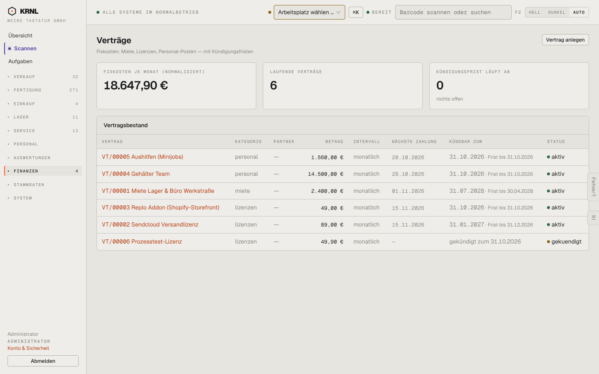

# 852-vertraege — Verträge

- **Bereich:** Auswertungen & Finanzen
- **Route:** `/finanzen/vertraege`
- **Note:** 3 / 5
- **Zweck:** Fixkosten-Verträge mit Kündigungsfristen
- **Messwerte:** HTTP 200 · Ladezeit 749 ms · Seitenhöhe 900 px · horizontaler Überlauf nein · Texte < 11 px: 24

## Was gut ist

- Normalisierte Fixkosten je Monat
- Kündbar zum + Frist je Vertrag

## Befunde

| Schwere | Kategorie | Befund | Vorschlag |
|---|---|---|---|
| **hoch** | Status | ‚Kündigungsfrist läuft ab: 0 — nichts offen‘, obwohl drei Verträge eine Frist bis 31.10.2026 haben (in 14 Tagen). | Fristen der nächsten 30/60 Tage zählen und hervorheben. |
| **niedrig** | Texte | Kategorien kleingeschrieben (personal, miete, lizenzen); Partner überall ‚—‘. | Anzeigenamen, Partner pflegen. |

[← zur Übersicht](../README.md)
