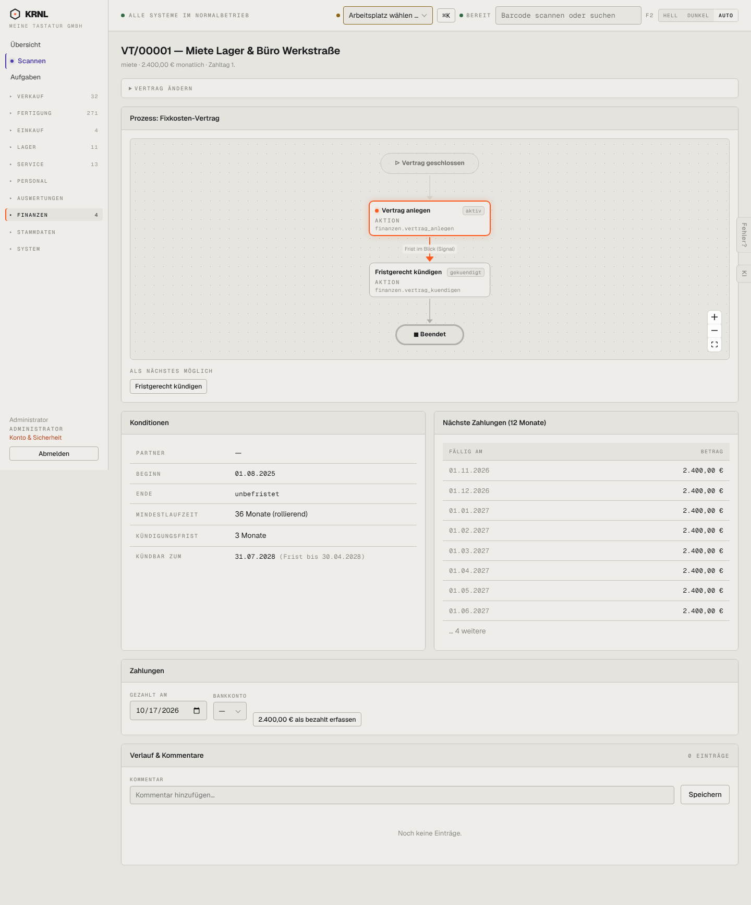

# 853-vertrag — Vertrag Detail

- **Bereich:** Auswertungen & Finanzen
- **Route:** `/finanzen/vertraege/3d3c7a17-7e93-4269-aa93-daa8230db2c7`
- **Note:** 3 / 5
- **Zweck:** Fixkosten-Vertrag mit Zahlungsplan
- **Messwerte:** HTTP 200 · Ladezeit 818 ms · Seitenhöhe 1733 px · horizontaler Überlauf nein · Texte < 11 px: 46

## Was gut ist

- Konditionen inkl. ‚kündbar zum … (Frist bis …)‘
- Nächste Zahlungen

## Befunde

| Schwere | Kategorie | Befund | Vorschlag |
|---|---|---|---|
| **mittel** | Logik | ‚2.400,00 € als bezahlt erfassen‘ mit Datum heute und ohne Bankkonto – fällig ist die nächste Rate erst am 01.11. | Fällige Rate auswählen lassen; Bankkonto Pflicht. |
| **niedrig** | Texte | Untertitel ‚miete · 2.400,00 € monatlich‘ kleingeschrieben; Diagramm zeigt nur 2 Schritte, nimmt aber 420 px ein. | Stepper statt Diagramm. |

[← zur Übersicht](../README.md)
