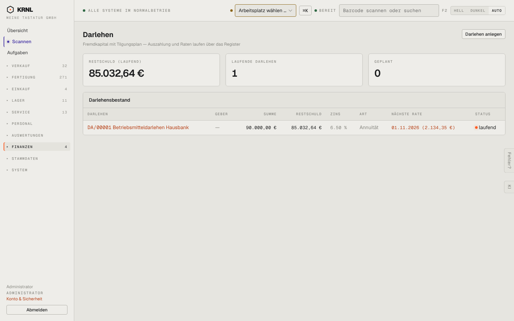

# 854-darlehen — Darlehen

- **Bereich:** Auswertungen & Finanzen
- **Route:** `/finanzen/darlehen`
- **Note:** 4 / 5
- **Zweck:** Darlehensbestand
- **Messwerte:** HTTP 200 · Ladezeit 759 ms · Seitenhöhe 900 px · horizontaler Überlauf nein · Texte < 11 px: 24

## Was gut ist

- Restschuld, nächste Rate je Darlehen

## Befunde

| Schwere | Kategorie | Befund | Vorschlag |
|---|---|---|---|
| **niedrig** | Typografie | Zins ‚6.50 %‘ mit Punkt; Status ‚laufend‘ mit orangem Punkt (Warnfarbe) für einen Normalzustand. | de-DE; neutrale/grüne Farbe. |

[← zur Übersicht](../README.md)
