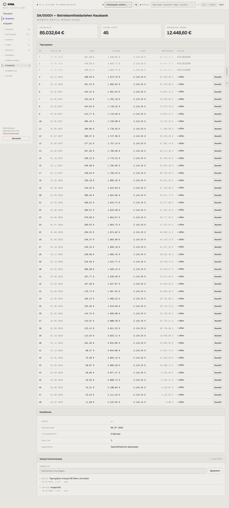

# 855-darlehen-detail — Darlehen Detail

- **Bereich:** Auswertungen & Finanzen
- **Route:** `/finanzen/darlehen/b7a12ed4-5002-4c76-a9b3-967b5f1f6015`
- **Note:** 3 / 5
- **Zweck:** Darlehen mit Tilgungsplan
- **Messwerte:** HTTP 200 · Ladezeit 736 ms · Seitenhöhe 3187 px · horizontaler Überlauf nein · Texte < 11 px: 34

## Was gut ist

- Vollständiger Tilgungsplan, bezahlte Raten grün mit Datum

## Befunde

| Schwere | Kategorie | Befund | Vorschlag |
|---|---|---|---|
| **mittel** | Konsistenz | 45 ‚Bezahlt‘-Knöpfe – auch für Raten in 2029; ein Fehlklick bucht eine Zahlung in der Zukunft. | Nur die nächste fällige Rate buchbar. |
| **niedrig** | Layout | 48 Zeilen ohne Jahresgruppierung. | Nach Jahr gruppieren, Vergangenes einklappen. |

[← zur Übersicht](../README.md)
