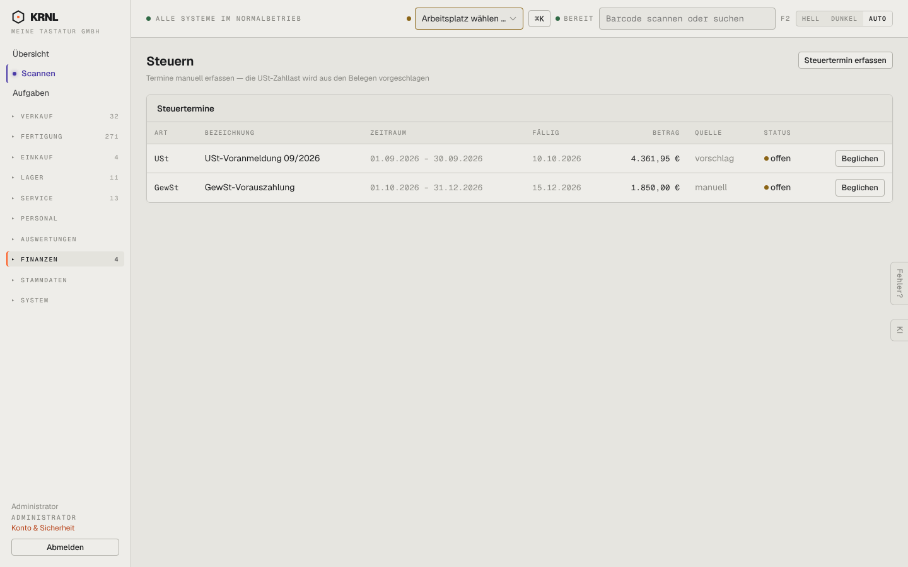

# 856-steuern — Steuern

- **Bereich:** Auswertungen & Finanzen
- **Route:** `/finanzen/steuern`
- **Note:** 3 / 5
- **Zweck:** Steuertermine (USt-Vorschlag aus Belegen)
- **Messwerte:** HTTP 200 · Ladezeit 707 ms · Seitenhöhe 900 px · horizontaler Überlauf nein · Texte < 11 px: 20

## Was gut ist

- Quelle Vorschlag/manuell

## Befunde

| Schwere | Kategorie | Befund | Vorschlag |
|---|---|---|---|
| **hoch** | Status | USt-Voranmeldung 09/2026, fällig 10.10.2026, steht als ‚offen‘ (orange) – sieben Tage überfällig, ohne Überfällig-Kennzeichnung. | Überfällig rot + Hinweis auf der Übersicht. |
| **niedrig** | Texte | ‚vorschlag‘/‚manuell‘ kleingeschrieben. | Anzeigenamen. |

[← zur Übersicht](../README.md)
