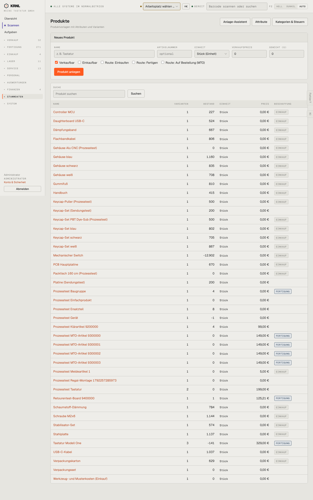

# 900-produkte — Produkte

- **Bereich:** Stammdaten & System
- **Route:** `/produkte`
- **Note:** 2 / 5
- **Zweck:** Produktvorlagen mit Varianten, Bestand, Preis, Beschaffung
- **Messwerte:** HTTP 200 · Ladezeit 843 ms · Seitenhöhe 2299 px · horizontaler Überlauf nein · Texte < 11 px: 57

## Was gut ist

- Beschaffungsweg als Etikett (Einkauf/Fertigung)
- Anlage-Assistent und Attribute verlinkt

## Befunde

| Schwere | Kategorie | Befund | Vorschlag |
|---|---|---|---|
| **hoch** | Daten | Alle Komponenten zeigen Preis 0,00 € (gemeint: Verkaufspreis, für Einkaufsteile irrelevant) – der Einkaufs-/Einstandspreis fehlt in der Liste; negativer Bestand (Switch −12.902) ohne Warnung. | Spalten je Typ: Verkaufspreis nur für verkaufbare, sonst Ø Einstand; negativer Bestand rot. |
| **mittel** | Layout | Formular ‚Neues Produkt‘ mit Routen-Checkboxen dominiert den Kopf, obwohl es einen Anlage-Assistenten gibt (zwei Wege zum Anlegen). | Nur Assistent bzw. Knopf ‚Neues Produkt‘. |
| **mittel** | Filter | Keine Filter (verkaufbar/einkaufbar/Fertigung/Testartikel), keine Seitenaufteilung. | Chips nach Beschaffung + Typ. |
| **niedrig** | Daten | Mehrere Produkte ohne Beschaffungsweg (leere Spalte), z. B. Keycap-Set (Sendungstest). | ‚— nicht festgelegt‘ als Warnung. |

[← zur Übersicht](../README.md)
