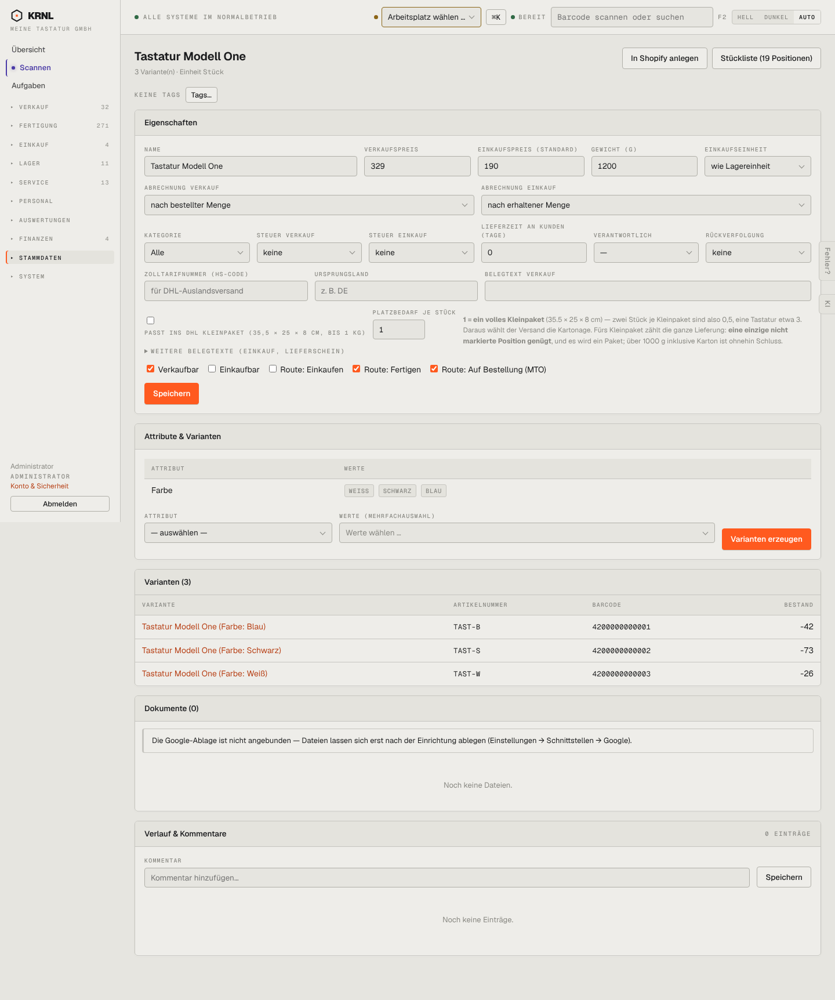

# 901-produkt — Produkt Detail

- **Bereich:** Stammdaten & System
- **Route:** `/produkte/f43c725d-1d86-4bae-821d-ad94d321acfc`
- **Note:** 2 / 5
- **Zweck:** Produktvorlage: Eigenschaften, Attribute, Varianten, Dokumente
- **Messwerte:** HTTP 200 · Ladezeit 774 ms · Seitenhöhe 1724 px · horizontaler Überlauf nein · Texte < 11 px: 49

## Was gut ist

- Varianten mit SKU/Barcode/Bestand
- Kleinpaket-Erklärung mit Rechenbeispiel
- ‚In Shopify anlegen‘ und Stückliste direkt im Kopf

## Befunde

| Schwere | Kategorie | Befund | Vorschlag |
|---|---|---|---|
| **hoch** | Daten | Steuer Verkauf ‚keine‘ beim Hauptprodukt (Tastatur, 329 €) – falsche Steuerbasis für Rechnungen; keine Warnung. | Pflichtfeld bei verkaufbaren Produkten bzw. Standardsteuer aus Kategorie. |
| **mittel** | Layout | 18 Felder in einem Raster ohne Gruppierung (Preise, Logistik, Zoll, Belegtexte, Routen gemischt). | Abschnitte: Verkauf · Einkauf · Logistik/Versand · Zoll · Fertigung. |
| **niedrig** | Eingabe | Checkbox ‚Passt ins DHL Kleinpaket‘ steht über ihrem Label in Versalien, schwer zuzuordnen. | Schalter mit Label rechts. |

[← zur Übersicht](../README.md)
