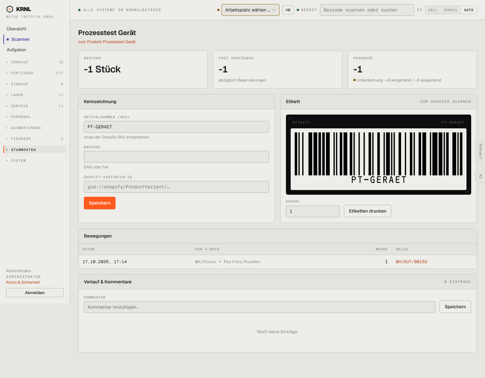

# 902-variante — Variante Detail

- **Bereich:** Stammdaten & System
- **Route:** `/produkte/variante/dd0e4dc7-bb52-4461-868d-acc46b654999`
- **Note:** 3 / 5
- **Zweck:** Variante: SKU, Barcode, Shopify-ID, Etikett, Bewegungen
- **Messwerte:** HTTP 200 · Ladezeit 726 ms · Seitenhöhe 1122 px · horizontaler Überlauf nein · Texte < 11 px: 29

## Was gut ist

- Bestand/frei/Prognose
- Etikett mit Vorschau und Druckanzahl
- Hinweis ‚muss der Shopify-SKU entsprechen‘

## Befunde

| Schwere | Kategorie | Befund | Vorschlag |
|---|---|---|---|
| **mittel** | Status | Bestand ‚−1 Stück‘ groß, ohne Hinweis auf die Ursache (Ausgang ohne Bestand WH/OUT/00152). | Warnbox ‚Negativer Bestand – Inventur/Wareneingang prüfen‘. |
| **niedrig** | Konsistenz | Etikettenvorschau als schwarzer Rahmen um weißes Etikett. | Etikett ohne Terminal-Rahmen. |

[← zur Übersicht](../README.md)
