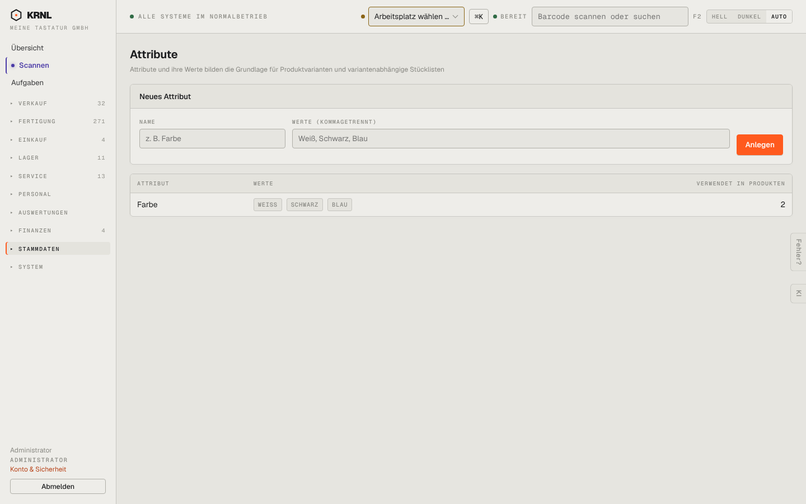

# 903-attribute — Attribute

- **Bereich:** Stammdaten & System
- **Route:** `/produkte/attribute`
- **Note:** 4 / 5
- **Zweck:** Attribute und Werte für Varianten
- **Messwerte:** HTTP 200 · Ladezeit 720 ms · Seitenhöhe 900 px · horizontaler Überlauf nein · Texte < 11 px: 21

## Was gut ist

- Kompakt, Verwendung in Produkten gezählt

## Befunde

| Schwere | Kategorie | Befund | Vorschlag |
|---|---|---|---|
| **niedrig** | Funktion | Werte sind nicht bearbeitbar/umbenennbar aus der Liste (kein Bearbeiten-Link). | Werte als editierbare Chips. |

[← zur Übersicht](../README.md)
