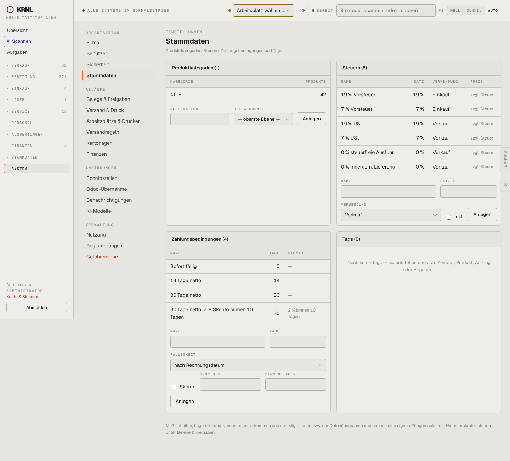

# 904-konfiguration — Produktkonfiguration

- **Bereich:** Stammdaten & System
- **Route:** `/produkte/konfiguration`
- **Note:** 3 / 5
- **Zweck:** Einstellungen → Stammdaten: Kategorien, Steuern, Zahlungsbedingungen, Tags
- **Messwerte:** HTTP 200 · Ladezeit 903 ms · Seitenhöhe 1302 px · horizontaler Überlauf nein · Texte < 11 px: 37

## Was gut ist

- Vier Bereiche übersichtlich nebeneinander
- Hinweis, wo Nummernkreise liegen

## Befunde

| Schwere | Kategorie | Befund | Vorschlag |
|---|---|---|---|
| **mittel** | Navigation | Aus Produkte → ‚Kategorien & Steuern‘ landet man unter SYSTEM (Seitenleiste springt um). | Stammdaten-Einstellungen unter Stammdaten führen oder Rücksprung anbieten. |
| **niedrig** | Texte | Fußnote erwähnt ‚Migrationen‘ – Entwicklerbegriff. | ‚werden vom System vorgegeben‘. |

[← zur Übersicht](../README.md)
