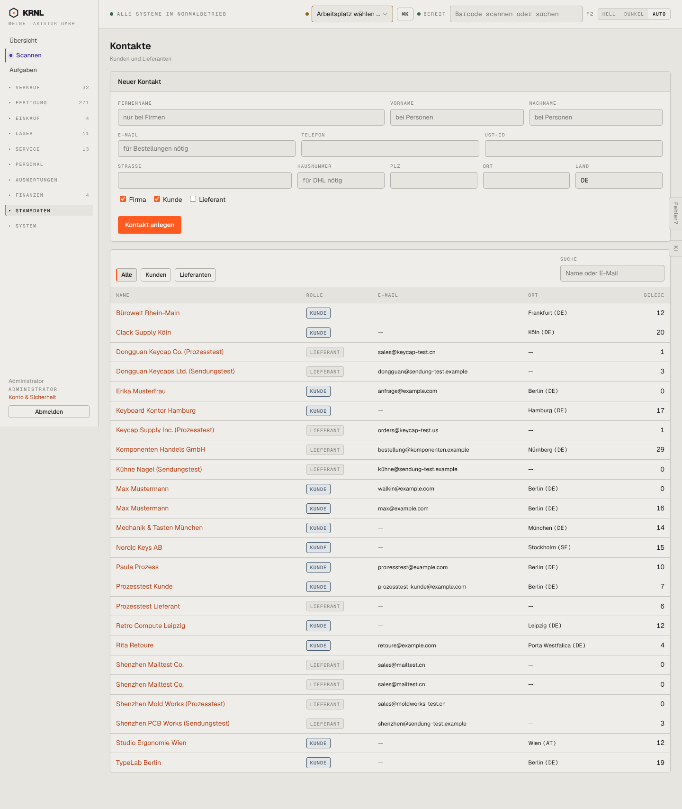

# 910-kontakte — Kontakte

- **Bereich:** Stammdaten & System
- **Route:** `/kontakte`
- **Note:** 3 / 5
- **Zweck:** Kunden und Lieferanten
- **Messwerte:** HTTP 200 · Ladezeit 806 ms · Seitenhöhe 1707 px · horizontaler Überlauf nein · Texte < 11 px: 54

## Was gut ist

- Filter Kunden/Lieferanten, Suche
- Belegzahl je Kontakt

## Befunde

| Schwere | Kategorie | Befund | Vorschlag |
|---|---|---|---|
| **mittel** | Daten | Dubletten: ‚Max Mustermann‘ zweimal (verschiedene Mails), ‚Shenzhen Mailtest Co.‘ zweimal (gleiche Mail). | Dublettenprüfung beim Anlegen + Zusammenführen. |
| **mittel** | Layout | Formular ‚Neuer Kontakt‘ (11 Felder) über der Liste. | Knopf + Dialog. |
| **niedrig** | Daten | Viele Firmenkunden ohne E-Mail (‚—‘) – laut Formular ‚für Bestellungen nötig‘. | Fehlende Pflichtangaben markieren. |

[← zur Übersicht](../README.md)
