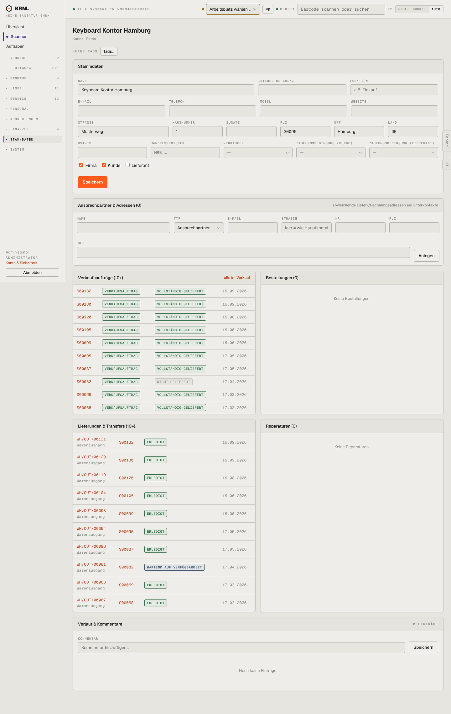

# 911-kontakt-firma — Kontakt Firma (Kunde)

- **Bereich:** Stammdaten & System
- **Route:** `/kontakte/e20716fd-b07d-4842-a351-ba5287364a19`
- **Note:** 3 / 5
- **Zweck:** Kontaktakte Firmenkunde
- **Messwerte:** HTTP 200 · Ladezeit 850 ms · Seitenhöhe 2276 px · horizontaler Überlauf nein · Texte < 11 px: 72

## Was gut ist

- Verkaufsaufträge, Lieferungen, Bestellungen, Reparaturen am Kontakt
- Ansprechpartner/Adressen als Unterkontakte

## Befunde

| Schwere | Kategorie | Befund | Vorschlag |
|---|---|---|---|
| **mittel** | Status | Spalte Status zeigt erneut ‚VERKAUFSAUFTRAG‘ (Belegart) bei jedem Auftrag. | Nur Liefer-/Rechnungsstatus. |
| **mittel** | Funktion | Keine Rechnungen/offenen Posten, kein Umsatz am Kunden. | Karte ‚Rechnungen & offene Posten‘ + Umsatz 12 Monate. |
| **niedrig** | Eingabe | Ansprechpartner-Formular: Ort-Feld über volle Breite in eigener Zeile, Straße mit Platzhalter ‚leer = wie Hauptkontakt‘ abgeschnitten. | Adresszeile kompakt. |

[← zur Übersicht](../README.md)
