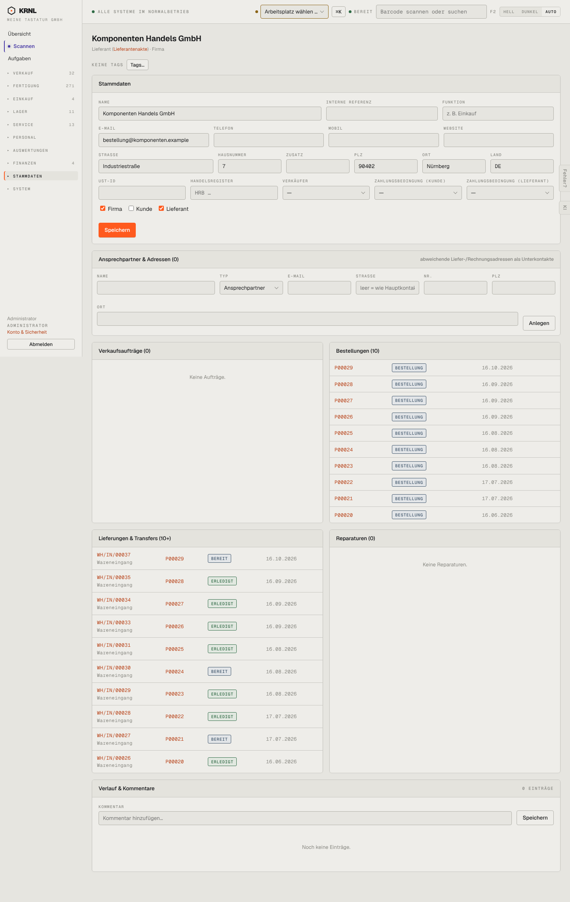

# 912-kontakt-lieferant — Kontakt Lieferant

- **Bereich:** Stammdaten & System
- **Route:** `/kontakte/fc150acc-f35e-47d4-ad63-55beff6db61e`
- **Note:** 3 / 5
- **Zweck:** Kontaktakte (Variante Lieferant)
- **Messwerte:** HTTP 200 · Ladezeit 825 ms · Seitenhöhe 2276 px · horizontaler Überlauf nein · Texte < 11 px: 62

## Was gut ist

- Gleicher Aufbau wie Kunde

## Befunde

| Schwere | Kategorie | Befund | Vorschlag |
|---|---|---|---|
| **niedrig** | Konsistenz | Zwei Akten für Lieferanten: Kontakte/[id] und Einkauf/Lieferanten/[id] mit unterschiedlichem Inhalt. | Eine Akte mit Reitern (Stammdaten · Einkauf · Verkauf). |

[← zur Übersicht](../README.md)
