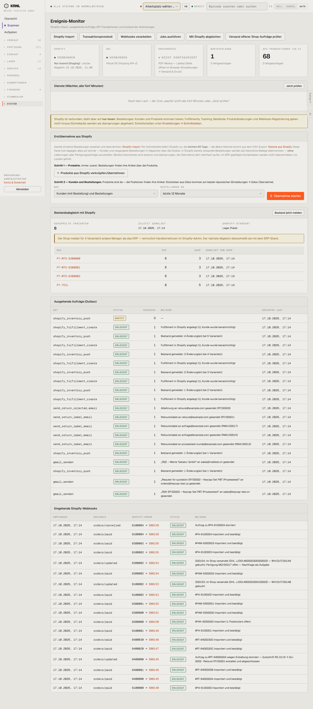

# 950-integrationen — Integrationen

- **Bereich:** Stammdaten & System
- **Route:** `/integrationen`
- **Note:** 2 / 5
- **Zweck:** Ereignis-Monitor: Anbindungen, Outbox, Shopify-Abgleich
- **Messwerte:** HTTP 200 · Ladezeit 835 ms · Seitenhöhe 3255 px · horizontaler Überlauf nein · Texte < 11 px: 75

## Was gut ist

- Zustand je Anbindung als Kacheln
- Klarer Hinweis ‚Shopify nur lesen‘
- Bestandsabweichungen ERP vs. Shop als Tabelle

## Befunde

| Schwere | Kategorie | Befund | Vorschlag |
|---|---|---|---|
| **hoch** | Logik | Shopify steht auf ‚nur lesen‘, trotzdem melden die Outbox-Einträge ‚Bestand gemeldet‘ und ‚Fulfillment in Shopify angelegt, Kunde wurde benachrichtigt‘ als ERLEDIGT – widersprüchlich (im Fake-Modus ausgeführt, aber nicht gekennzeichnet). | Übersprungene/simulierte Jobs als ‚übersprungen (nur lesen)‘ bzw. ‚Test‘ markieren. |
| **mittel** | Layout | Sechs gleichrangige Aktionsknöpfe oben (Import, Protokoll, Webhooks, Jobs, Abgleich, Versand prüfen) ohne Erklärung, wann man was braucht. | Gruppieren: Navigation (Import/Protokoll) vs. Wartung (Webhooks/Jobs/Abgleich) im Menü. |
| **mittel** | Texte | Outbox zeigt technische Job-Namen (shopify_inventory_push). | Klartext (‚Bestand an Shopify melden‘). |
| **niedrig** | Status | ‚Dienste: Noch kein Lauf‘ – Wächter lief nie, ohne Warnfarbe. | Gelb, wenn länger als 10 Minuten kein Lauf. |

[← zur Übersicht](../README.md)
