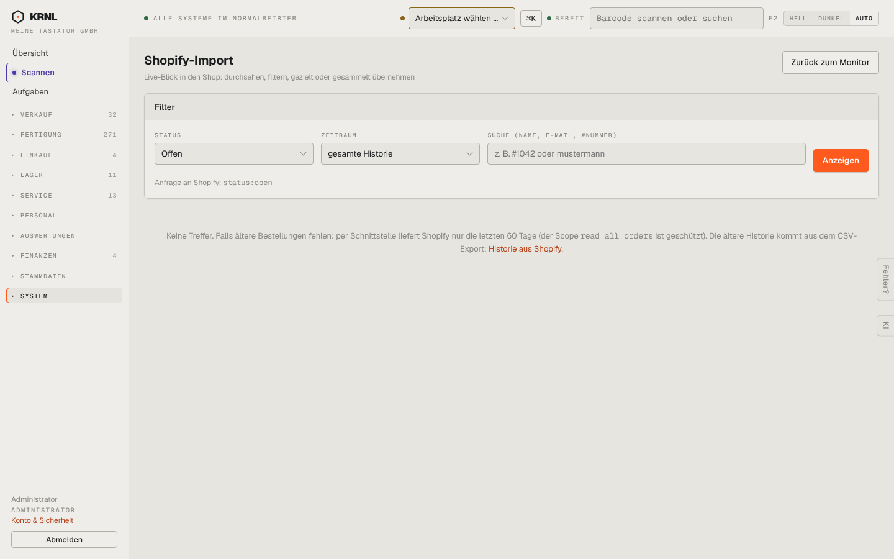

# 951-integrationen-import — Import

- **Bereich:** Stammdaten & System
- **Route:** `/integrationen/import`
- **Note:** 3 / 5
- **Zweck:** Shopify-Bestellungen live durchsehen und übernehmen
- **Messwerte:** HTTP 200 · Ladezeit 738 ms · Seitenhöhe 900 px · horizontaler Überlauf nein · Texte < 11 px: 16

## Was gut ist

- Shopify-Suchsyntax sichtbar (status:open)
- Leerzustand erklärt die 60-Tage-Grenze mit Link zur Historie

## Befunde

| Schwere | Kategorie | Befund | Vorschlag |
|---|---|---|---|
| **niedrig** | Texte | Technische Begriffe im Leerzustand (Scope read_all_orders) ohne Erklärung. | In Fußnote/Tooltip verschieben. |

[← zur Übersicht](../README.md)
