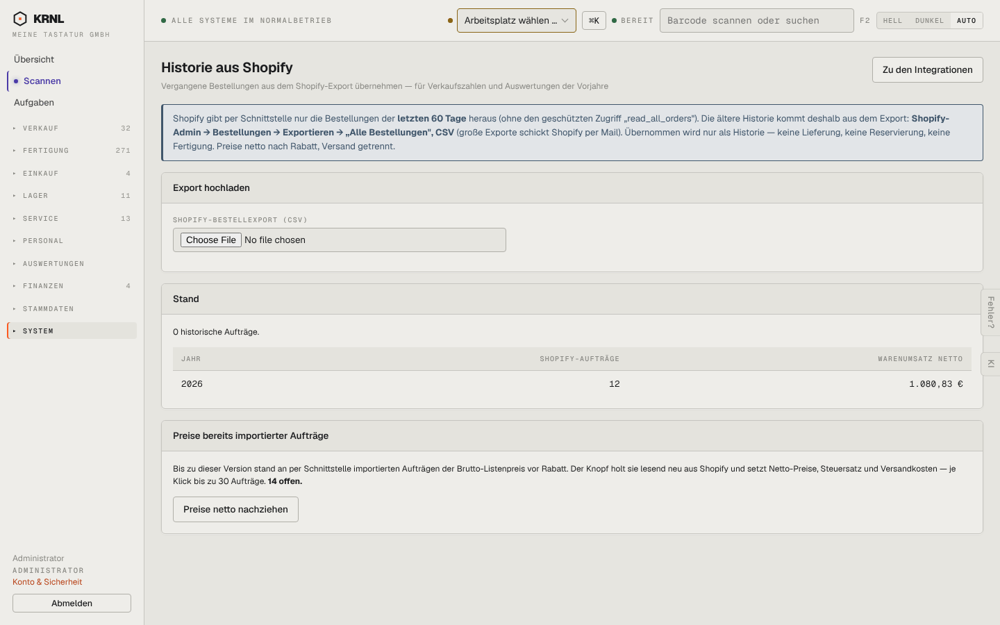

# 952-integrationen-historie — Historie aus Shopify

- **Bereich:** Stammdaten & System
- **Route:** `/integrationen/historie`
- **Note:** 3 / 5
- **Zweck:** Historische Shopify-Bestellungen per CSV übernehmen
- **Messwerte:** HTTP 200 · Ladezeit 785 ms · Seitenhöhe 900 px · horizontaler Überlauf nein · Texte < 11 px: 17

## Was gut ist

- Schrittanleitung für den Export im Hinweisbanner
- Stand je Jahr

## Befunde

| Schwere | Kategorie | Befund | Vorschlag |
|---|---|---|---|
| **mittel** | Texte | Dateiauswahl zeigt englischen Browsertext ‚Choose File / No file chosen‘. | Eigene Upload-Zone (‚CSV hierher ziehen oder auswählen‘). |
| **niedrig** | Logik | ‚0 historische Aufträge‘ über einer Tabelle mit 12 Aufträgen 2026 – widersprüchlich (Tabelle zählt API-Importe). | Tabelle beschriften (‚alle Shopify-Aufträge je Jahr, davon historisch: 0‘). |

[← zur Übersicht](../README.md)
