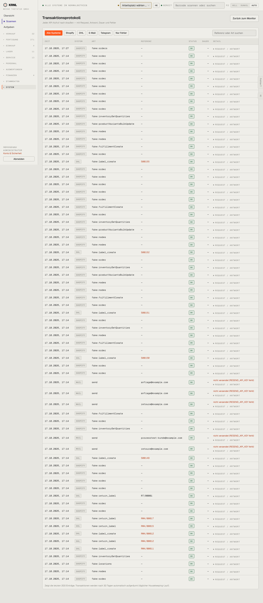

# 953-integrationen-transaktionen — Transaktionen

- **Bereich:** Stammdaten & System
- **Route:** `/integrationen/transaktionen`
- **Note:** 3 / 5
- **Zweck:** Protokoll aller API-Aufrufe
- **Messwerte:** HTTP 200 · Ladezeit 835 ms · Seitenhöhe 3295 px · horizontaler Überlauf nein · Texte < 11 px: 365

## Was gut ist

- Filter je System + Nur Fehler, Suche
- Request/Antwort aufklappbar

## Befunde

| Schwere | Kategorie | Befund | Vorschlag |
|---|---|---|---|
| **mittel** | Status | Fake-Aufrufe (fake:order) erscheinen als normales ‚OK‘ – im Testbetrieb nicht vom echten Verkehr unterscheidbar. | Etikett ‚TEST/FAKE‘ und Filter. |
| **niedrig** | Leistung | Keine Seitenaufteilung, Spalte Dauer überall ‚—‘, Referenz meist leer. | Seitenaufteilung; Dauer messen; Referenz befüllen. |

[← zur Übersicht](../README.md)
