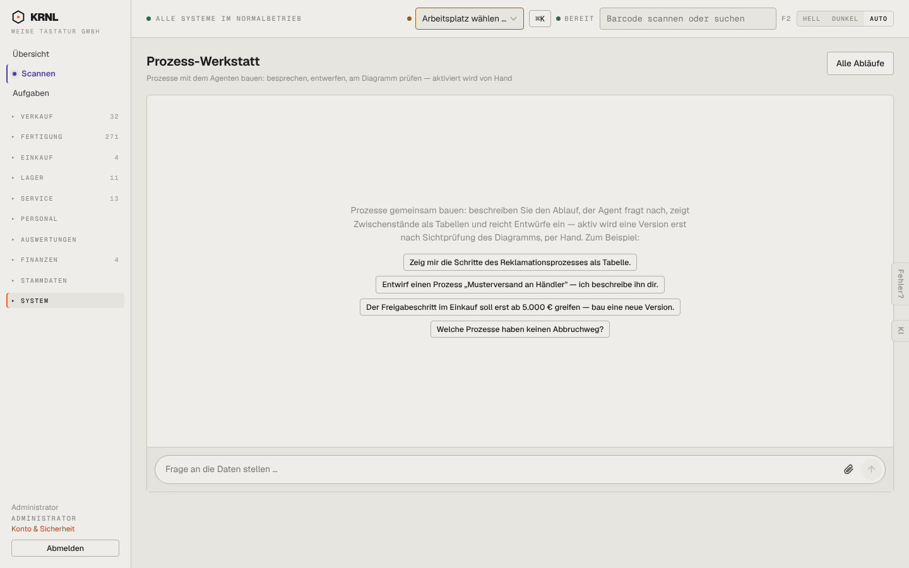

# 961-werkstatt — Prozess-Werkstatt

- **Bereich:** Stammdaten & System
- **Route:** `/prozesse/werkstatt`
- **Note:** 3 / 5
- **Zweck:** Prozess-Werkstatt: Prozesse mit dem Agenten entwerfen
- **Messwerte:** HTTP 200 · Ladezeit 829 ms · Seitenhöhe 900 px · horizontaler Überlauf nein · Texte < 11 px: 13

## Was gut ist

- Beispielaufträge als Knöpfe
- Prinzip ‚aktiviert wird von Hand‘ erklärt

## Befunde

| Schwere | Kategorie | Befund | Vorschlag |
|---|---|---|---|
| **mittel** | Texte | Eingabefeld-Platzhalter ‚Frage an die Daten stellen …‘ ist von der KI-Analyse kopiert – hier geht es um Prozessentwürfe. | ‚Ablauf beschreiben oder Änderung wünschen …‘. |
| **niedrig** | Layout | Keine Liste laufender Entwürfe/Versionen neben dem Chat. | Seitenleiste ‚Entwürfe‘ mit Status. |

[← zur Übersicht](../README.md)
