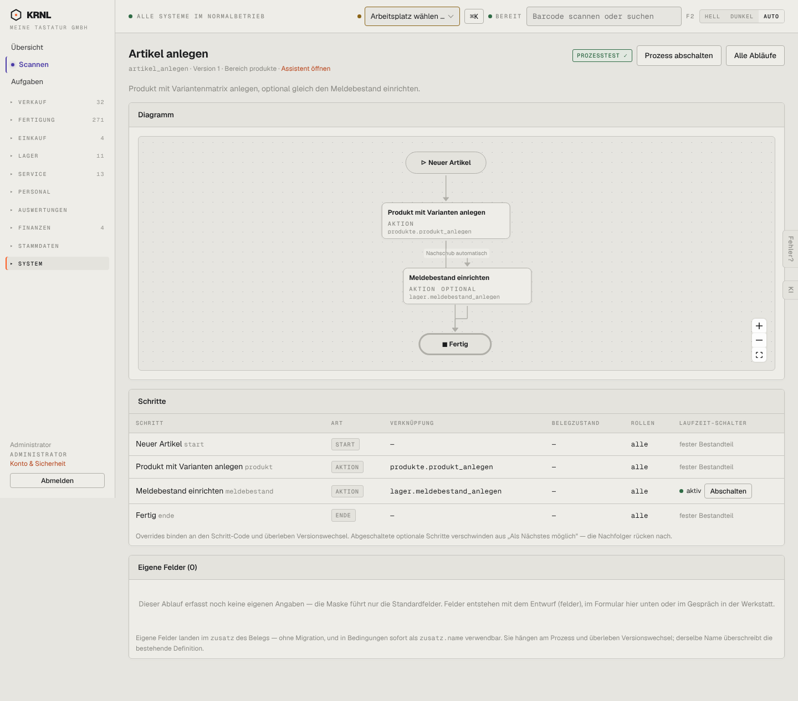

# 962-prozess-artikel_anlegen — Prozessdefinition „Artikel anlegen“

- **Bereich:** Stammdaten & System
- **Route:** `/prozesse/artikel_anlegen`
- **Note:** 4 / 5
- **Zweck:** Prozessdefinition „Artikel anlegen (Assistent)“: Diagramm, Schritte mit Aktion/Belegzustand/Rollen, Laufzeit-Schalter, eigene Felder
- **Messwerte:** HTTP 200 · Ladezeit 813 ms · Seitenhöhe 1267 px · horizontaler Überlauf nein · Texte < 11 px: 31

## Was gut ist

- Einheitlicher Aufbau aller Prozessseiten
- Prozesstest-Status grün im Kopf
- Optionale Schritte einzeln abschaltbar

## Befunde

| Schwere | Kategorie | Befund | Vorschlag |
|---|---|---|---|
| **mittel** | Barrierefreiheit | Diagramm in Originalgröße unlesbar (Knotenschrift ~7 px, abgeschnittene Knotentitel), bei großen Abläufen winzig in einer 600-px-Fläche. | Diagramm auf Breite einpassen + Minimalschrift 11 px; Knotentitel umbrechen statt abschneiden. |
| **mittel** | Texte | Belegzustände als Codes in der Schritttabelle (z. B. draft, confirmed, under_repair) gemischt mit deutschen (geprueft, angeboten). | Anzeigenamen je Zustand, Code nur als Tooltip. |
| **niedrig** | Navigation | Link ‚Assistent öffnen‘ nur klein im Untertitel. | Als Knopf im Kopf. |
| **niedrig** | Eingabe | Formular ‚Eigene Felder‘ mit Platzhaltern ‚liefertermin / Liefertermin / klein, mittel, groß‘, die wie Werte aussehen; Erklärtext erwähnt ‚Migration‘ und ‚zusatz.name‘. | Klarere Platzhalter, Erklärung ohne Technikbegriffe. |

[← zur Übersicht](../README.md)
