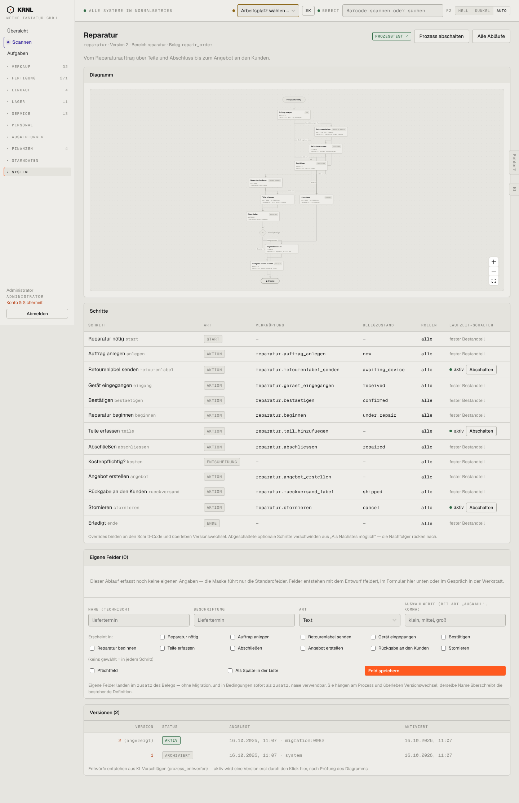

# 962-prozess-reparatur — Prozessdefinition „Reparatur“

- **Bereich:** Stammdaten & System
- **Route:** `/prozesse/reparatur`
- **Note:** 3 / 5
- **Zweck:** Prozessdefinition „Reparatur“: Diagramm, Schritte mit Aktion/Belegzustand/Rollen, Laufzeit-Schalter, eigene Felder
- **Messwerte:** HTTP 200 · Ladezeit 806 ms · Seitenhöhe 2224 px · horizontaler Überlauf nein · Texte < 11 px: 83

## Was gut ist

- Einheitlicher Aufbau aller Prozessseiten
- Prozesstest-Status grün im Kopf
- Optionale Schritte einzeln abschaltbar

## Befunde

| Schwere | Kategorie | Befund | Vorschlag |
|---|---|---|---|
| **hoch** | Schritte | ‚Angebot erstellen‘ liegt nach ‚Abschließen‘ – bei kostenpflichtigen Reparaturen fehlt die Freigabe des Kostenvoranschlags vor Reparaturbeginn. | Entscheidung ‚kostenpflichtig?‘ vor ‚Reparatur beginnen‘ mit Schritt ‚Kostenvoranschlag freigeben‘. |
| **mittel** | Barrierefreiheit | Diagramm in Originalgröße unlesbar (Knotenschrift ~7 px, abgeschnittene Knotentitel), bei großen Abläufen winzig in einer 600-px-Fläche. | Diagramm auf Breite einpassen + Minimalschrift 11 px; Knotentitel umbrechen statt abschneiden. |
| **mittel** | Texte | Belegzustände als Codes in der Schritttabelle (z. B. draft, confirmed, under_repair) gemischt mit deutschen (geprueft, angeboten). | Anzeigenamen je Zustand, Code nur als Tooltip. |
| **niedrig** | Texte | Englische Zustandscodes (awaiting_device, under_repair, shipped). | Deutsch. |
| **niedrig** | Eingabe | Formular ‚Eigene Felder‘ mit Platzhaltern ‚liefertermin / Liefertermin / klein, mittel, groß‘, die wie Werte aussehen; Erklärtext erwähnt ‚Migration‘ und ‚zusatz.name‘. | Klarere Platzhalter, Erklärung ohne Technikbegriffe. |

[← zur Übersicht](../README.md)
