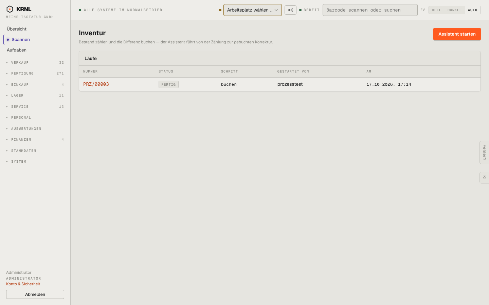

# 963-assistent-inventur — Assistent: Inventur

- **Bereich:** Stammdaten & System
- **Route:** `/p/inventur`
- **Note:** 3 / 5
- **Zweck:** Assistent Inventur: Läufe und Start
- **Messwerte:** HTTP 200 · Ladezeit 758 ms · Seitenhöhe 900 px · horizontaler Überlauf nein · Texte < 11 px: 18

## Was gut ist

- Primärknopf ‚Assistent starten‘
- Läufe mit Status und Schritt

## Befunde

| Schwere | Kategorie | Befund | Vorschlag |
|---|---|---|---|
| **mittel** | Navigation | Zwei Inventur-Einstiege (Lager → Inventur und dieser Assistent unter /p/inventur) mit unterschiedlicher Bedienung; Seitenleiste markiert hier keinen Bereich. | Ein Einstieg; Assistent aus Lager → Inventur starten; aktiven Bereich setzen. |
| **niedrig** | Texte | Schritt-Spalte zeigt Codes (buchen, ende, meldebestand). | Schrittnamen. |

[← zur Übersicht](../README.md)
