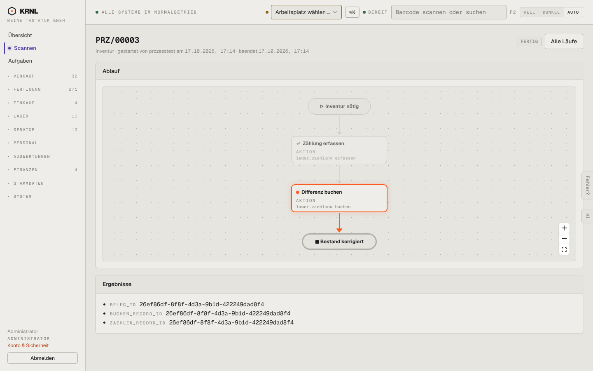

# 964-assistent-inventur-instanz — Assistent-Instanz Inventur

- **Bereich:** Stammdaten & System
- **Route:** `/p/inventur/570a4d48-36a4-4cdd-9247-7ca4c7d06a40`
- **Note:** 2 / 5
- **Zweck:** Einzelner Assistentenlauf (fertig)
- **Messwerte:** HTTP 200 · Ladezeit 796 ms · Seitenhöhe 900 px · horizontaler Überlauf nein · Texte < 11 px: 21

## Was gut ist

- Ablauf mit erledigten Schritten

## Befunde

| Schwere | Kategorie | Befund | Vorschlag |
|---|---|---|---|
| **hoch** | Texte | ‚Ergebnisse‘ zeigen nur rohe UUIDs (beleg_id, buchen_record_id …) – für Anwender wertlos. | Verlinkte Belege mit Namen (‚Inventurbuchung WH/INV/…, 3 Positionen‘). |
| **mittel** | Status | Status ‚FERTIG‘, aber das Diagramm markiert ‚Differenz buchen‘ orange als aktuell. | Bei fertig den Endknoten markieren. |

[← zur Übersicht](../README.md)
