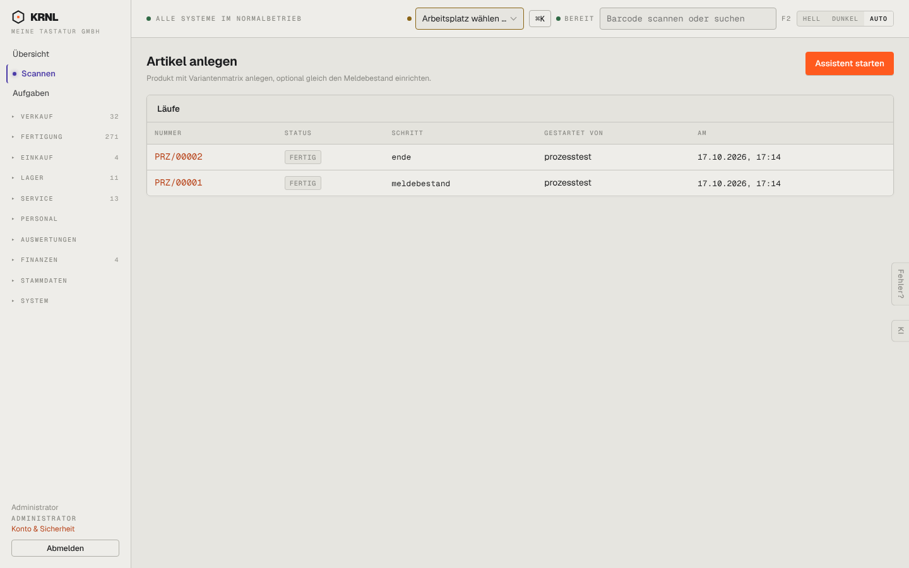

# 965-assistent-artikel — Assistent: Artikel anlegen

- **Bereich:** Stammdaten & System
- **Route:** `/p/artikel_anlegen`
- **Note:** 3 / 5
- **Zweck:** Assistent Artikel anlegen: Läufe und Start
- **Messwerte:** HTTP 200 · Ladezeit 725 ms · Seitenhöhe 900 px · horizontaler Überlauf nein · Texte < 11 px: 19

## Was gut ist

- Wie 963

## Befunde

| Schwere | Kategorie | Befund | Vorschlag |
|---|---|---|---|
| **niedrig** | Navigation | Gleiche Doppelung wie 963 (Produkte → Anlage-Assistent vs. Formular auf 900). | Ein Weg. |

[← zur Übersicht](../README.md)
