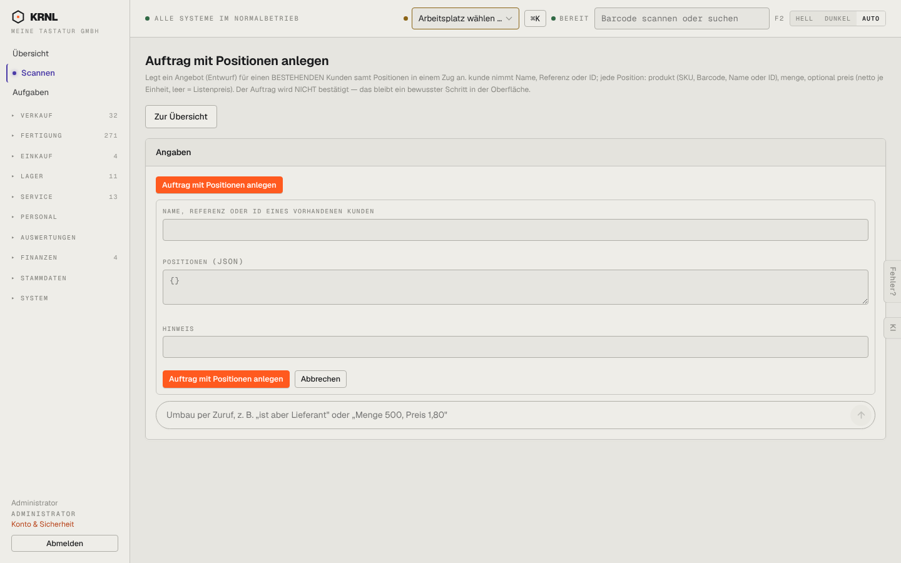

# 966-aktion — Aktionsmaske (generiert)

- **Bereich:** Stammdaten & System
- **Route:** `/aktion/verkauf.auftrag_mit_positionen`
- **Note:** 2 / 5
- **Zweck:** Generische Aktionsmaske (aus der Registry erzeugt), hier ‚Auftrag mit Positionen anlegen‘
- **Messwerte:** HTTP 200 · Ladezeit 724 ms · Seitenhöhe 900 px · horizontaler Überlauf nein · Texte < 11 px: 15

## Was gut ist

- Beweist das Prinzip ‚Masken aus Aktionen‘
- KI-Umbau per Zuruf

## Befunde

| Schwere | Kategorie | Befund | Vorschlag |
|---|---|---|---|
| **hoch** | Eingabe | Positionen müssen als JSON (‚{}‘) eingegeben werden – für Anwender unbenutzbar. | Für Listenparameter eine Positionstabelle generieren. |
| **mittel** | Konsistenz | Zwei orange Knöpfe gleichen Namens (Aufklapper und Absenden); Kunde als Freitext ‚Name, Referenz oder ID‘ statt Auswahl. | Ein Absendeknopf; Partnerauswahl mit Suche. |

[← zur Übersicht](../README.md)
