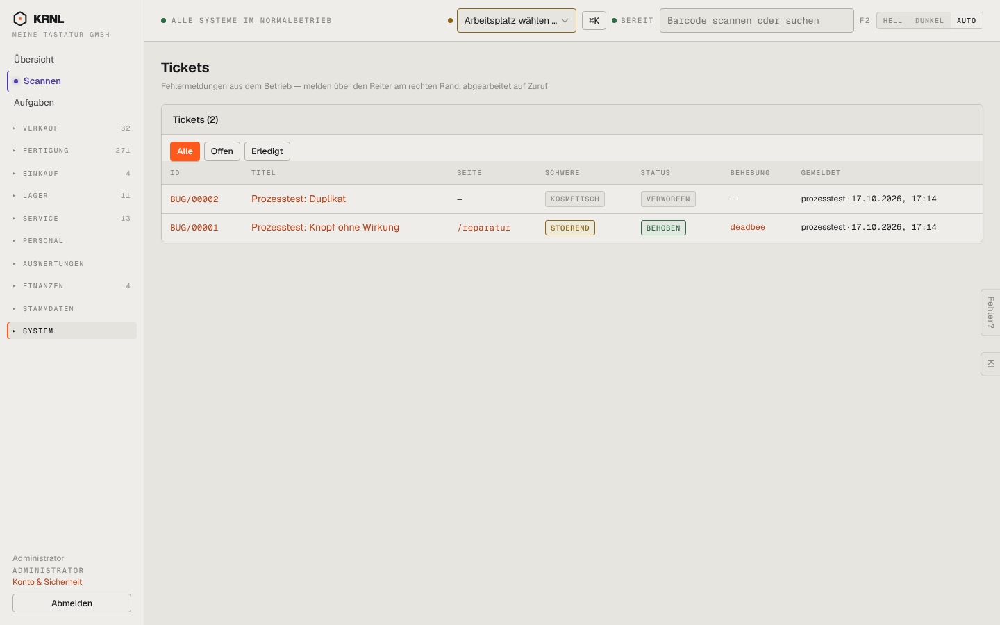

# 970-tickets — Tickets

- **Bereich:** Stammdaten & System
- **Route:** `/tickets`
- **Note:** 4 / 5
- **Zweck:** Fehlermeldungen aus dem Betrieb
- **Messwerte:** HTTP 200 · Ladezeit 764 ms · Seitenhöhe 900 px · horizontaler Überlauf nein · Texte < 11 px: 23

## Was gut ist

- Schwere und Status farbig, Behebung mit Commit verlinkt
- Filter Offen/Erledigt

## Befunde

| Schwere | Kategorie | Befund | Vorschlag |
|---|---|---|---|
| **niedrig** | Texte | Schwere/Status in Versalien ohne Umlaut (STOEREND). | ‚Störend‘. |

[← zur Übersicht](../README.md)
