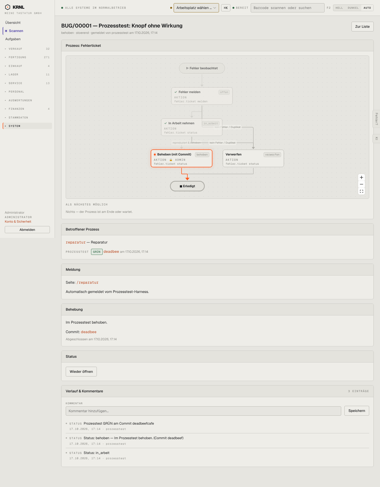

# 971-ticket-behoben — Ticket behoben

- **Bereich:** Stammdaten & System
- **Route:** `/tickets/804970e4-cc7c-4023-b23d-ef00fefe40a0`
- **Note:** 3 / 5
- **Zweck:** Behobenes Fehlerticket
- **Messwerte:** HTTP 200 · Ladezeit 809 ms · Seitenhöhe 1842 px · horizontaler Überlauf nein · Texte < 11 px: 40

## Was gut ist

- Betroffener Prozess mit Prozesstest-Status (GRÜN) und Commit
- ‚Wieder öffnen‘

## Befunde

| Schwere | Kategorie | Befund | Vorschlag |
|---|---|---|---|
| **niedrig** | Status | Diagramm markiert ‚Beheben‘ als aktuellen Schritt, obwohl erledigt; ‚Nichts — der Prozess ist am Ende oder wartet.‘ | Endknoten markieren, ‚Behoben am …‘. |

[← zur Übersicht](../README.md)
