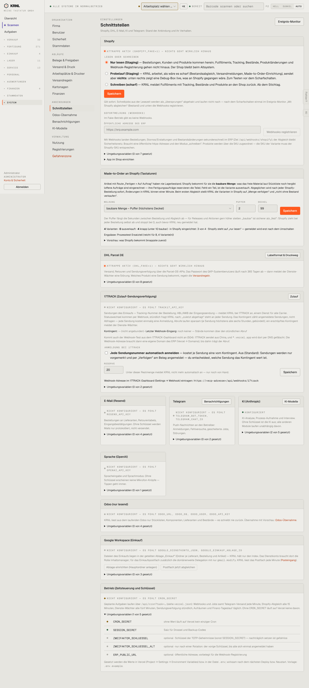

# 980-einstellungen-anbindungen — Anbindungen

- **Bereich:** Stammdaten & System
- **Route:** `/einstellungen/anbindungen`
- **Note:** 3 / 5
- **Zweck:** Schnittstellen: Shopify, Made-to-Order, DHL, 17TRACK, Mail, Telegram
- **Messwerte:** HTTP 200 · Ladezeit 865 ms · Seitenhöhe 3197 px · horizontaler Überlauf nein · Texte < 11 px: 31

## Was gut ist

- Je Anbindung Status (Attrappe aktiv / nicht konfiguriert) und Modus
- Shopify-Modus mit drei klar erklärten Stufen (lesen/Probelauf/schreiben)
- MTO-Meldung mit Puffer/Deckel und Vorschau

## Befunde

| Schwere | Kategorie | Befund | Vorschlag |
|---|---|---|---|
| **mittel** | Layout | 3.200 px lange Seite mit allen Anbindungen untereinander; dichter Fließtext je Karte. | Übersichtskacheln mit Status, Detail je Anbindung auf Unterseite. |
| **mittel** | Konsistenz | Begriff wechselt: Menü ‚Schnittstellen‘, Route ‚anbindungen‘, Überwachung ‚Integrationen/Ereignis-Monitor‘. | Ein Begriff (‚Anbindungen‘). |
| **niedrig** | Texte | Umgebungsvariablen-Namen und Entwicklerdetails (SHOPIFY_FAKE=1, *.vercel.app, Scope) im Fließtext. | In aufklappbaren ‚Technische Details‘. |

[← zur Übersicht](../README.md)
