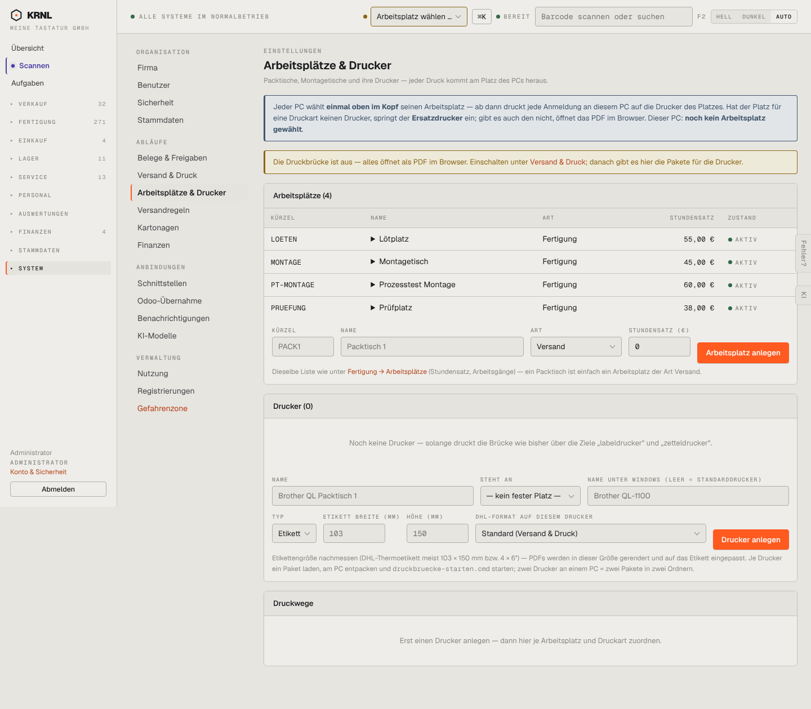

# 980-einstellungen-arbeitsplaetze — Arbeitsplätze & Drucker

- **Bereich:** Stammdaten & System
- **Route:** `/einstellungen/arbeitsplaetze`
- **Note:** 3 / 5
- **Zweck:** Arbeitsplätze & Drucker (Druckwege je Platz)
- **Messwerte:** HTTP 200 · Ladezeit 922 ms · Seitenhöhe 1259 px · horizontaler Überlauf nein · Texte < 11 px: 50

## Was gut ist

- Klare Erklärung ‚Jeder PC wählt einmal oben im Kopf seinen Arbeitsplatz‘
- Warnung ‚Druckbrücke ist aus‘

## Befunde

| Schwere | Kategorie | Befund | Vorschlag |
|---|---|---|---|
| **mittel** | Konsistenz | Dieselben Arbeitsplätze (LOETEN, MONTAGE …) werden auch unter Fertigung → Arbeitsplätze gepflegt – zwei Masken für dieselben Daten. | Eine Maske, von beiden Orten verlinkt. |
| **niedrig** | Eingabe | Drucker-Platzhalter ‚Brother QL Packtisch 1 / Brother QL-1100 / 103 / 150‘ wirken wie vorbelegte Werte. | ‚z. B.‘-Platzhalter. |

[← zur Übersicht](../README.md)
