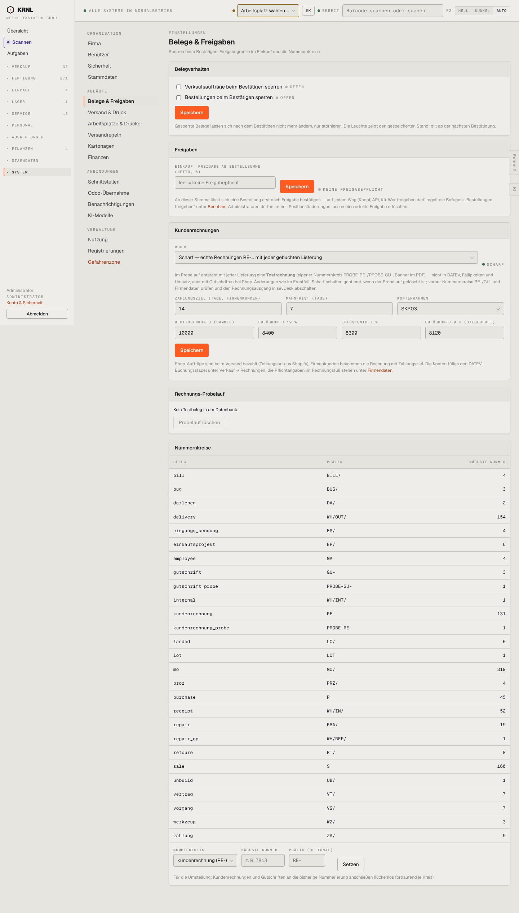

# 980-einstellungen-belege — Belege & Freigaben

- **Bereich:** Stammdaten & System
- **Route:** `/einstellungen/belege`
- **Note:** 3 / 5
- **Zweck:** Belege & Freigaben: Sperren, Freigabegrenze, Kundenrechnungen (Modus, Konten), Probelauf, Nummernkreise
- **Messwerte:** HTTP 200 · Ladezeit 869 ms · Seitenhöhe 2527 px · horizontaler Überlauf nein · Texte < 11 px: 33

## Was gut ist

- Modus der Kundenrechnung als Auswahl mit Erklärung (Probelauf/scharf)
- Nummernkreise mit nächster Nummer

## Befunde

| Schwere | Kategorie | Befund | Vorschlag |
|---|---|---|---|
| **hoch** | Status | Der Rechnungsmodus (heikles Thema laut Betreiber) ist nur eine Auswahl in der dritten Karte mit kleinem Status ‚● SCHARF‘ – kein deutlicher Hinweis, was scharf bedeutet und dass Pflichtangaben fehlen (vgl. Firma). | Eigene Karte ‚Rechnungsmodus‘ ganz oben mit großem Status, Checkliste der Voraussetzungen, Bestätigungsdialog beim Umschalten. |
| **mittel** | Texte | Nummernkreise mit technischen Schlüsseln (bill, bug, delivery, employee) und Präfix BILL/. | Deutsche Belegnamen. |
| **niedrig** | Logik | ‚Probelauf löschen‘ ausgegraut ohne Erklärung (kein Testbeleg). | Hinweis neben dem Knopf. |

[← zur Übersicht](../README.md)
