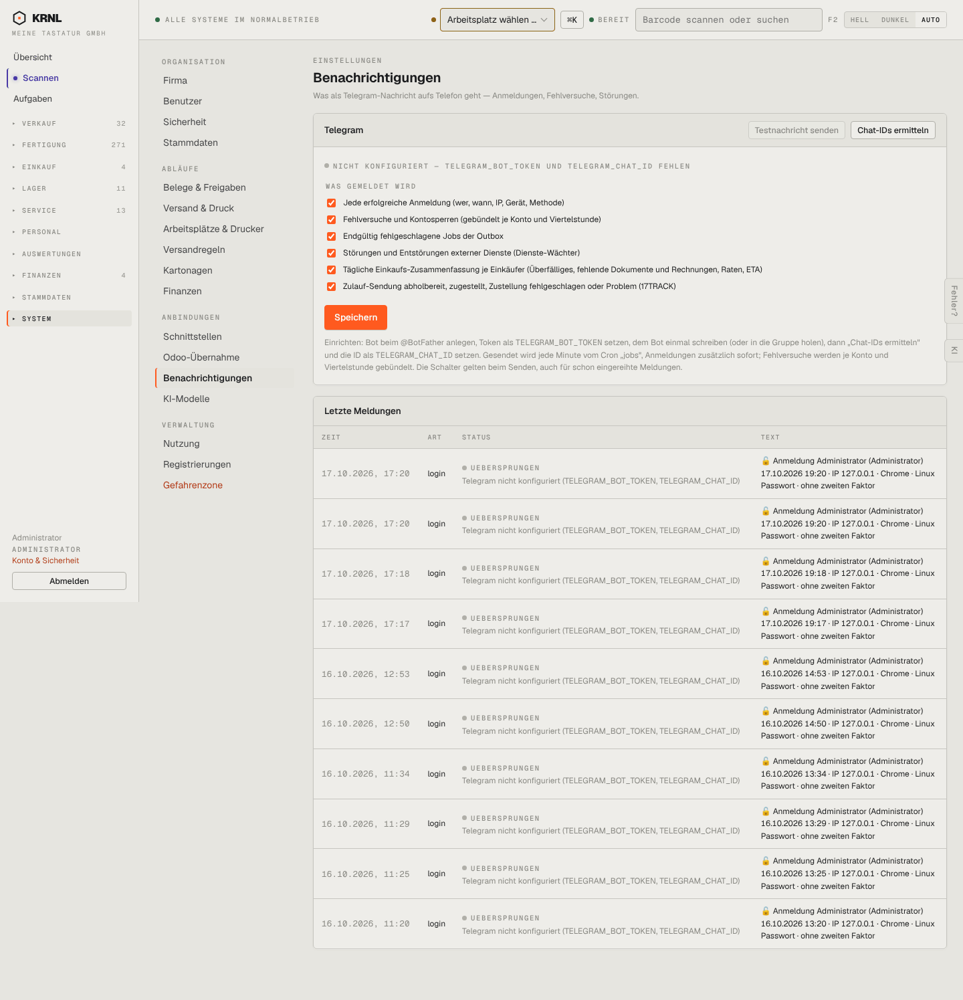

# 980-einstellungen-benachrichtigungen — Benachrichtigungen

- **Bereich:** Stammdaten & System
- **Route:** `/einstellungen/benachrichtigungen`
- **Note:** 3 / 5
- **Zweck:** Telegram-Meldungen konfigurieren, letzte Meldungen
- **Messwerte:** HTTP 200 · Ladezeit 863 ms · Seitenhöhe 1495 px · horizontaler Überlauf nein · Texte < 11 px: 23

## Was gut ist

- Was gemeldet wird als Checkliste
- Protokoll der letzten Meldungen mit Status

## Befunde

| Schwere | Kategorie | Befund | Vorschlag |
|---|---|---|---|
| **hoch** | Status | Telegram ist nicht konfiguriert; alle Login-Meldungen wurden ‚übersprungen‘ – diese Lücke (vom Betreiber bemerkt: seit 1.10. keine Meldungen) steht nur als kleine graue Zeile. | Rotes Banner ‚Telegram nicht eingerichtet – Meldungen gehen verloren‘ + Hinweis auf der Übersicht. |
| **niedrig** | Texte | Status ‚UEBERSPRUNGEN‘ ohne Umlaut. | ‚Übersprungen‘. |

[← zur Übersicht](../README.md)
