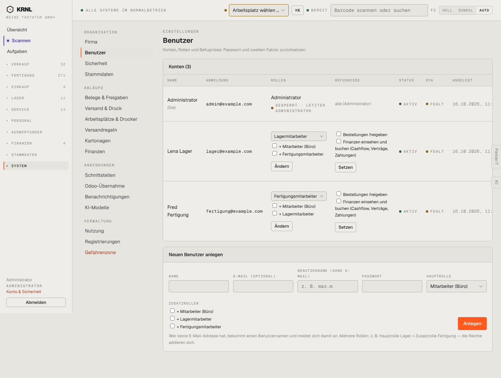

# 980-einstellungen-benutzer — Benutzer

- **Bereich:** Stammdaten & System
- **Route:** `/einstellungen/benutzer`
- **Note:** 3 / 5
- **Zweck:** Benutzer, Rollen, Befugnisse, 2FA
- **Messwerte:** HTTP 200 · Ladezeit 901 ms · Seitenhöhe 1086 px · horizontaler Überlauf nein · Texte < 11 px: 31

## Was gut ist

- Haupt- und Zusatzrollen
- Befugnisse je Person (Bestellungen freigeben, Finanzen)

## Befunde

| Schwere | Kategorie | Befund | Vorschlag |
|---|---|---|---|
| **mittel** | Layout | Je Benutzer zwei getrennte Formulare mit eigenen Knöpfen (‚Ändern‘ für Rollen, ‚Setzen‘ für Befugnisse) in einer Tabellenzeile. | Benutzer-Detaildialog mit einem Speichern. |
| **niedrig** | Status | 2FA ‚FEHLT‘ in Warnfarbe, obwohl die Sicherheitsregel ‚freiwillig‘ ist. | Neutral ‚nicht eingerichtet‘. |

[← zur Übersicht](../README.md)
